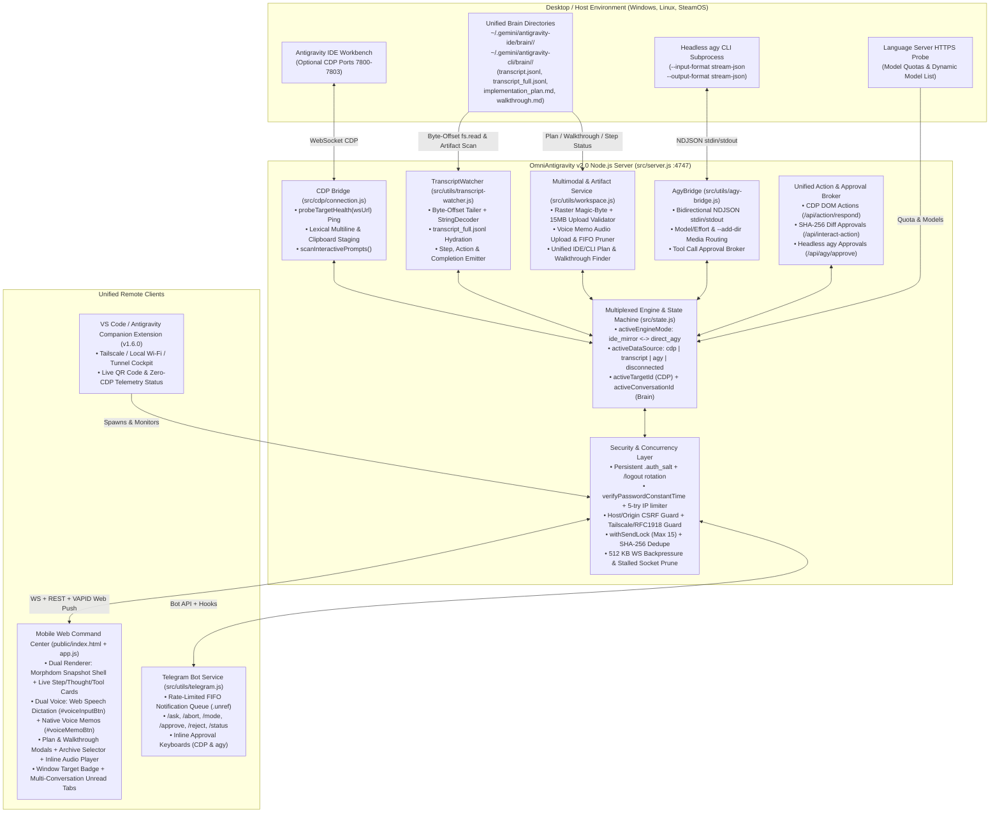

# Master Architectural Merge & Integration Plan: OmniAntigravity v2.0
## Unifying Branch A (Steam Deck Mobile UX & 360° Audit) and Branch B (Windows Zero-CDP Telemetry, `agy` CLI Bridge & Companion Extension)

- **Document ID:** `PLAN-MERGE-SD-ZCDP-V2`
- **Orchestrator:** Lead Principal Systems & AI Architect (Gemini 4 Argon High)
- **Target Workspace:** `C:\Users\hoppj\SynologyDrive\01_Projets\OmniAntigravityRemoteChat`
- **Merge Base Commit:** `02ad8c6000504491057fa2a830b06c6de7001ef7`
- **Branch A (Steam Deck Evolution):** `origin/feat/native-voice-memo-attachment` (`77d8fd6`) — 28 commits, 114 files changed (`+19,567 / -3,056` lines)
- **Branch B (Windows Evolution):** `feat/zero-cdp-telemetry-and-extension` (`b4c91da`) — 1 consolidated commit, 49 files changed (`+14,030 / -327` lines)
- **3-Way Merge Tree Hash (`git merge-tree`):** `23f56cf321acbe560cced42c6152e10637865691` (18 overlapping modified files: 14 with explicit Git conflict markers totaling 55 conflict blocks, and 4 auto-merged files with critical semantic interactions)

---

## 1. Executive Summary & Evolutionary Lineage

Following commit `02ad8c60`, **OmniAntigravity Remote Chat** evolved along two major, high-velocity parallel architectural tracks:

1. **Branch A — Steam Deck Evolution (`origin/feat/native-voice-memo-attachment` @ `77d8fd6`, v1.6.0):**
   - **Multimodal Native Voice Memos & Media Staging:** In-browser `MediaRecorder` capture (`#voiceMemoBtn`, `#voiceRecordingBar`), `#stagedMediaSlot` attachment staging, `/api/upload-audio` and `/api/upload-media` endpoints, Lexical clipboard/file staging, and inline chat `<audio>` waveform player enrichment (`enrichChatArtifactLinks`).
   - **Mobile Implementation Plan & Walkthrough Review System (`TICKET-DOM04-003`, `TICKET-DOM04-004`):** Dedicated mobile Plan & Walkthrough preview modals (`#planPreviewModal`, `#walkthroughPreviewModal`), archive history selectors (`/api/plan`, `/api/plans`, `/api/walkthrough`, `/api/walkthroughs`), 1-tap approval (`Proceed`), structured review comment submission, and workspace target badges.
   - **Interactive Action Decision System & Native Question Mirroring:** Floating `#actionCardSlot`, `scanInteractivePrompts`, `/api/action/pending`, `/api/action/respond`, optimistic radio/checkbox selection (`label[for^="ask-opt-"]`), and 2-step confirmation for critical commands.
   - **Multi-Conversation Tabs & Window Management:** `.window-conversation-bar` with per-window conversation tabs (`omni_tabs_by_window_v1`), `localStorage` unread step counters (`omni_unread_state_v1`), `/api/conversations/status`, and `/api/close-window` with last-window protection.
   - **360° Security, Concurrency & Robustness Audit (25 Resolved Tickets across 15 Domains):** Active CDP health ping (`probeTargetHealth`), `createServer()` route mounting, bounded `withSendLock` queue + SHA-256 prompt deduplication, Lexical `Shift+Enter` multiline staging, 512 KB WebSocket backpressure & dead-socket pruning, RFC 1918 octet validation, persistent `.auth_salt`, `safeTimingCompare`, symlink workspace boundary checks, process-group terminal kill, FIFO upload retention, and 11 new Vitest unit test suites.

2. **Branch B — Windows Evolution (`feat/zero-cdp-telemetry-and-extension` @ `b4c91da`, v1.4.0):**
   - **Full Zero-CDP Tri-Modal Engine:**
     - `src/utils/transcript-watcher.js`: Stateful byte-offset tailing of `transcript.jsonl` across `~/.gemini/antigravity-ide/brain` and `~/.gemini/antigravity-cli/brain` with UTF-8 `StringDecoder` boundary safety and automatic truncation hydration from sibling `transcript_full.jsonl`.
     - `src/utils/agy-bridge.js`: Headless subprocess manager for `agy.exe` (`--input-format stream-json --output-format stream-json` and `--print`), supporting multi-turn NDJSON streaming over `stdin`/`stdout`, model/effort selection, and interactive tool approvals (`approve()` / `abort()`).
   - **Multiplexed Data Source State Machine & Engine Switcher:** Real-time `activeDataSource` (`transcript` | `agy` | `cdp` | `disconnected`) and `activeEngineMode` (`ide_mirror` ↔ `direct_agy`), `/api/transcript/*`, `/api/agy/*`, `/api/engine/mode`, and Zero-CDP fallbacks on `/send`, `/stop`, `/chat-history`, and `/app-state`.
   - **Antigravity 2.0 Reasoning & Diff Approval UI:** Reasoning effort selector pills (`low`, `medium`, `high`, `max`), `ANTIGRAVITY_MODELS` metadata (`Gemini 4 Argon`, `Claude 5.5`), streaming `.thought-card` (`thinking`) and `.tool-card` components, SHA-256 `actionHash` verification with color-coded unified diff previews (`renderApprovalCard`), Web Speech API dictation (`#voiceInputBtn`), and RFC 8292 VAPID Web Push notifications.
   - **Enhanced Telegram Bot & VS Code Companion Extension:** Telegram `/ask <prompt>`, `/abort`, `/mode`, inline `agy_approve`/`agy_reject` callbacks, and the complete `vscode-extension/` (VSIX v1.4.0) with Tailscale/Local/Tunnel switcher, QR generator, and multi-layer credential persistence.

### Summary of Overlap & Conflict Topology

| Category | File Count | Files |
|---|:---:|---|
| **Overlapping with Explicit 3-Way Git Conflicts** | **14** | `src/server.js` (26), `public/js/app.js` (12), `public/index.html` (3), `README.md` (2), `src/utils/network.js` (2), `src/utils/workspace.js` (2), `.gitignore` (1), `public/css/chat.css` (1), `public/sw.js` (1), `src/config.js` (1), `src/quota-service.js` (1), `src/state.js` (1), `src/supervisor.js` (1), `src/utils/process.js` (1) |
| **Overlapping Auto-Merged by Git (Require Semantic Audit)** | **4** | `src/utils/telegram.js`, `scripts/pinggy-tunnel.js`, `package.json`, `test/test.js` |
| **Branch-A-Only Modified/Added Files** | **96** | `.agents/tickets/*`, `AUDIT_*.md`, `RESOLUTION_ORCHESTRATION_MASTER.md`, `CHANGELOG.md`, `src/cdp/connection.js`, `src/screenshot-timeline.js`, `public/css/components.css`, `public/css/layout.css`, `public/admin.html`, `public/login.html`, `test/unit/{action-decision,close-window,conversation-tabs-unread,mobile-viewport,native-audio-attachment,plan-archive-and-walkthrough,send-lock,simulated-e2e-workflows,upload-audio,upload-image,upload-media}.test.js`, etc. |
| **Branch-B-Only Modified/Added Files** | **31** | `src/utils/transcript-watcher.js`, `src/utils/agy-bridge.js`, `src/utils/hash.js`, `public/js/components/assist-panel.js`, `test/unit/{transcript-watcher,agy-bridge}.test.js`, `vscode-extension/*`, `scripts/build-extension.js`, `docs/{PLAN_ZERO_CDP_ORCHESTRATION,SECURITY_AUDIT_REPORT,TAILSCALE_SETUP_GUIDE,TELEGRAM_BOT_GUIDE}.md`, etc. |

---

## 2. 'Best of Both Worlds' Unified Architecture (OmniAntigravity v2.0)



### 2.1 How Voice Memos, Audio Attachments & Dictation Interact Across CDP and Zero-CDP `agy` Modes

OmniAntigravity v2.0 preserves **both** voice paradigms side-by-side in `.input-wrapper` with hardware microphone arbitration:

1. **Dual Voice Controls & Microphone Mutual Exclusion (`public/index.html` & `public/js/app.js`):**
   - **`#voiceInputBtn` (`.voice-btn`, Branch B):** Uses browser `SpeechRecognition` / `webkitSpeechRecognition` to transcribe speech directly into `#messageInput` in real time, displaying `#voiceIndicator` (`Listening...` / `Transcribing...`).
   - **`#voiceMemoBtn` (`.mic-btn`, Branch A):** Captures raw microphone audio via `MediaRecorder` (`audio/webm;codecs=opus` or `audio/mp4`), shows `#voiceRecordingBar` with a live timer (`00:00`), and stages the recording into `#stagedMediaSlot` with an interactive `<audio controls>` preview and size badge. Can be toggled on/off via `#voiceMemoSettingBtn` in `#headerOverflowDropdown`.
   - **Mutual Exclusion Guard:** Starting `startAudioRecording()` automatically checks `if (state.isListening && state.voiceRecognition) state.voiceRecognition.stop();`. Conversely, `toggleVoiceDictation()` checks `if (isRecordingAudio) return;` so both APIs never contend for the mobile device's audio input stream.

2. **Multimodal Delivery in CDP Mirror Mode (`activeEngineMode === 'ide_mirror'` with active `cdpConnection`):**
   - Staged audio (`POST /api/upload-audio`) or combined image+audio (`POST /api/upload-media`) is validated (`MAX_AUDIO_BYTES = 20 MB`, `MAX_IMAGE_BYTES = 15 MB` + raster magic-byte check), saved to `data/uploads/` with FIFO retention pruning (`pruneUploadsDirectory`), and injected into the Antigravity IDE composer via `injectMediaIntoChat(cdpConnection, ...)` using Lexical clipboard paste (`DataTransfer`) + markdown reference `[Voice memo: <filename>](file:///<absPath>)`.

3. **Multimodal Delivery in Zero-CDP / Headless `agy` Mode (`activeEngineMode === 'direct_agy'` or CDP Disconnected):**
   - Currently in Branch A, `POST /api/upload-audio`, `POST /api/upload-image`, and `POST /api/upload-media` return `503 CDP not connected` if `!cdpConnection` after saving the file.
   - **Unified v2.0 Behavior:**
     - The upload endpoints **always** validate and persist the file to `data/uploads/` first.
     - If `state.activeEngineMode === 'direct_agy'` or `!cdpConnection`:
       - Instead of returning `503`, if a `prompt`/`message` is provided (or when the staged media is sent), the server passes `addDir: uploadsDir` to `agyBridge.prompt({ prompt: enrichedPrompt, model, effort, addDir: uploadsDir })` where `enrichedPrompt` appends structured attachment descriptors (`\n\n[Attached Voice Memo: ${savedAudio.absolutePath}]\n[Attached Image: ${savedImage.absolutePath}]`).
       - The endpoint returns `200 { success: true, method: 'zero_cdp_staged', file: savedFile, url: '/uploads/' + savedFile.fileName }` so the mobile UI never fails when attaching voice memos or images in Zero-CDP mode!
   - **Inline Waveform Audio Rendering in Both Modes:**
     - Branch A's `enrichChatArtifactLinks()` transforms `[Voice memo: ...]` links and `/uploads/*.webm|*.mp4|*.ogg|*.wav|*.mp3` references into inline `<audio controls preload="metadata" class="chat-voice-memo-audio">` players.
     - In v2.0, `enrichChatArtifactLinks()` is invoked not only at the end of `renderSnapshot()` (CDP mode), but also inside `appendOrUpdateStepCard()` and `renderHistorySteps()` (Zero-CDP `transcript` and `agy` modes).

---

### 2.2 How Implementation Plan Review, Walkthroughs & Action Approvals Work Seamlessly Across CDP and Transcript/`agy` Modes

1. **Unified Multi-Brain Artifact Discovery (`src/utils/workspace.js`):**
   - Branch A's `findRecentImplementationPlans()`, `findLatestImplementationPlan()`, `findRecentWalkthroughs()`, and `findLatestWalkthrough()` scan `<brainRoot>/<conversationId>/implementation_plan.md` and `walkthrough.md`.
   - In v2.0, `brainRoots` is unified with `TRANSCRIPT_BRAIN_DIRS` from `src/config.js`:
     - `~/.gemini/antigravity-ide/brain`
     - `~/.gemini/antigravity-cli/brain`
     - `~/.gemini/antigravity/brain`
   - Additionally, `deriveWorkspaceNameFromPath(filePath)` is updated from `filePath.split('/')` to `filePath.split(/[\\/]/)` so conversation UUID extraction works identically on Windows (`\`) and Linux/SteamOS (`/`).
   - When `state.activeConversationId` (or `transcriptWatcher.currentConversationId`) is active, `/api/plan` and `/api/walkthrough` prioritize artifacts inside the active conversation directory before falling back to the globally newest `mtimeMs`.

2. **Tri-Layer Action & Approval Unification (`src/server.js` & `public/js/app.js`):**
   - **Layer 1 — CDP Interactive Prompts (`scanInteractivePrompts` + `detectPendingPromptFromHtml`):**
     - Detects live IDE `command`, `plan`, `walkthrough`, and `question` (`ask_question` / `grill-me`) prompts, enriches them with Branch B's `extractPendingActionDetails()` (`actionHash`, `diff`, `riskLevel`, `target`, `actionType`), stores `state.setCurrentPendingAction(detectedPrompt)` and `latestPendingAction`, and broadcasts `action_required` to render in `#actionCardSlot`.
   - **Layer 2 — Zero-CDP Transcript Action Detection (`transcriptWatcher.on('action_required')`):**
     - When `transcriptWatcher` detects a step with `status === 'WAITING_FOR_USER'`, `tc.name === 'ask_question'`, or `tc.status === 'WAITING_FOR_CONFIRMATION'`, `src/server.js` synthesizes a normalized `ActionPrompt` object:
       - If a tool call is `ask_question`, maps `tc.args.questions` into Branch A's `{ type: 'question', title, options, isMultiSelect, hasWriteIn }` schema!
       - If the step references `implementation_plan.md` with `RequestFeedback: true`, maps it into Branch A's `{ type: 'plan', title: 'Implementation Plan Ready', hasPreview: true, planPath }` schema!
       - If a tool call requires command/file approval, maps it into `{ type: 'command', command, actionHash, riskLevel }`!
     - Broadcasts both `{ type: 'action_required', source: 'transcript', step, action: synthesizedAction }` so `#actionCardSlot` and `#planPreviewModal` light up automatically even when CDP is disconnected.
   - **Layer 3 — Bidirectional Action Response Routing (`POST /api/action/respond` & `POST /api/interact-action`):**
     - Validates `optionIndex` (HTTP 400 on negative/non-integer per `TICKET-DOM04-001`) and `actionHash` (HTTP 409 on SHA-256 mismatch per Branch B).
     - When `state.activeEngineMode === 'direct_agy'` or `!cdpConnection`:
       - For `decision === 'accept' | 'proceed'` on a tool approval: delegates to `agyBridge.approve({ approved: true })`.
       - For `decision === 'reject' | 'skip'`: delegates to `agyBridge.approve({ approved: false, reason: reviewText })`.
       - For `decision === 'review'` (plan feedback) or `type === 'question'` (selected options / write-in answer): formats the review feedback or selected option text and dispatches it via `agyBridge.prompt({ prompt: formattedResponse })`!
     - When `cdpConnection` is active in `ide_mirror` mode: executes `executeActionResponse(cdpConnection, req.body)` and `injectMessage(cdpConnection, reviewText)` as designed in Branch A.

---

### 2.3 How Conversation Tabs Multiplex Both IDE Window Targets and Transcript/`agy` Sessions

1. **Window Badge & Target Selector (`#windowTargetBadge` & `/cdp-targets`):**
   - When CDP targets are available (`availableTargets.length > 0`), `#windowTargetBadge` displays the active IDE workspace window title (e.g., `OmniAntigravityRemoteChat`) with the close-window button (`#closeWindowBtn`, protected by `POST /api/close-window` last-window confirmation).
   - When operating in pure Zero-CDP mode (`availableTargets.length === 0` and `activeDataSource === 'transcript' | 'agy'`), `#windowTargetBadge` displays `Transcript Brain` (or `Direct agy CLI`) instead of remaining stuck on `Disconnected`, and scopes `localStorage` tab persistence (`omni_tabs_by_window_v1`) under the virtual window key `'__zero_cdp__'`.

2. **Unified Conversation History & Tab Switching (`GET /chat-history`, `POST /select-chat`, `GET /api/conversations/status`):**
   - **`GET /chat-history`**:
     - In CDP mode, scrapes the IDE conversation quick-pick list (`getChatHistory(cdpConnection)`).
     - In Zero-CDP fallback mode (or when CDP is disconnected), calls `await transcriptWatcher.listConversations({ limit: 30 })`, extracts a human-readable title from the first `USER_INPUT` step or plan title in that conversation's brain directory (falling back to the short conversation UUID), and returns rich objects `{ id: conv.id, chatId: conv.id, title, active: conv.id === transcriptWatcher.currentConversationId, workspace: conv.brainDir.includes('cli') ? 'agy CLI' : 'Antigravity IDE', date, mtimeMs }` compatible with Branch A's `showChatHistory()` and conversation tab bar!
   - **`POST /select-chat`**:
     - Accepts `{ title, chatId, workspace }`.
     - If `state.activeEngineMode === 'direct_agy'` or `!cdpConnection` (or when `chatId` matches a brain UUID on disk and CDP is not used), calls `await transcriptWatcher.selectConversation(chatId || title)` and broadcasts `transcript_history` + `datasource_status`.
     - If in CDP mode, runs Branch A's multi-window auto-targeting (switching CDP target window first if `workspace` matches another open IDE window) followed by `selectChat(cdpConnection, title)`, AND synchronizes `transcriptWatcher.selectConversation(chatId)` if `chatId` is known.
   - **`GET /api/conversations/status` & Real-Time Unread Counters:**
     - Branch A's `/api/conversations/status?ids=...` (`getConversationStatus` in `src/utils/workspace.js`) inspects `transcript.jsonl` across brain directories to return `{ stepIndex, status, updatedAt }` per conversation ID.
     - By adding `~/.gemini/antigravity-cli/brain` to `getConversationStatus()` AND hooking Branch B's WebSocket `case 'transcript_step':` in `public/js/app.js` to call `markChatAsRead(currentActiveChatId, data.step.step_index)` for the active tab (or increment unread count for background tabs), unread badges in `.conversation-tabs-list` update both via real-time WebSocket events and 8-second background polling!

---

### 2.4 Security & Robustness Coexistence Matrix (Steam Deck Audit × Zero-CDP Hardening)

| Domain | Steam Deck Audit Resolution (Branch A `77d8fd6`) | Windows Zero-CDP Hardening (Branch B `b4c91da`) | Unified v2.0 Coexistence Strategy |
|---|---|---|---|
| **DOM01: CDP Discovery & Routes** | `probeTargetHealth(wsUrl)` active V8 ping (`DOM01-001`); all routes mounted inside `createServer()` (`DOM01-002`); `isSwitchingTarget` mutex (`DOM01-003`). | Added `broadcastDataSourceStatus()`, `computeActiveDataSource()`, `LAUNCH_COOLDOWN_MS`, `MAX_TOTAL_TARGETS = 10`, and `/chat-history` transcript fallback inside `main()`. | Keep `src/cdp/connection.js` from Branch A (`probeTargetHealth`). Delete duplicate routes from `main()` (Conflict #26) and port all Branch B enhancements into the `createServer()` route handlers. |
| **DOM02 & DOM03: Send Lock & Lexical Staging** | `withSendLock` (bounded `MAX_SEND_QUEUE_DEPTH = 15`, HTTP 429), `ACTIVE_PROMPT_MAP` `try/finally` cleanup, SHA-256 duplicate guard (`DOM02-001/002`), Lexical `Shift+Enter` paragraph staging (`DOM03-001/002`). | Zero-CDP fallback in `POST /send` to `agyBridge.prompt()` when `activeEngineMode === 'direct_agy'` or `!cdpConnection`. | When `cdpConnection` is open and `activeEngineMode === 'ide_mirror'`, run Branch A's full `withSendLock` + Lexical pipeline. When `activeEngineMode === 'direct_agy'` or `!cdpConnection`: if `req.headers['x-require-cdp'] === 'true'` return 503; otherwise route to `agyBridge.prompt()` (satisfying `test/test.js` and `send-lock.test.js`). |
| **DOM04: Action Validation & Plan Review** | `optionIndex` integer validation (`DOM04-001`), `scanInteractivePrompts`, `/api/plan*`, `/api/walkthrough*`, `/api/action/respond` (`DOM04-003/004`). | SHA-256 `actionHash` verification (HTTP 409 on mismatch) in `/api/interact-action`, `extractPendingActionDetails`, and `/api/agy/approve`. | Preserve all `/api/plan*`, `/api/walkthrough*`, `/api/action/*`, and `/api/agy/*` routes. Combine `optionIndex` validation (400) + `actionHash` staleness check (409) in `/api/interact-action` and `/api/action/respond`. |
| **DOM05: WebSocket Backpressure & Shutdown** | `MAX_WS_BUFFERED_AMOUNT = 512 KB` frame drop + 15s stalled client termination (`DOM05-001`); timer/socket cleanup on shutdown (`DOM05-002`). | `transcriptWatcher.stop()`, `agyBridge.abort()`, and VAPID Web Push broadcast helpers. | Combine both in `src/server.js`: keep `MAX_WS_BUFFERED_AMOUNT` backpressure in `broadcast()` alongside VAPID push helpers, and run both CDP/WS cleanup and `transcriptWatcher`/`agyBridge` cleanup on `SIGINT`/`SIGTERM`. |
| **DOM06: Auth, LAN Bypass & CSRF** | Strict RFC 1918 4-octet validation fixing `172.32+` leak (`DOM06-001`); persistent `data/.auth_salt` (`DOM06-002`); `safeTimingCompare` (`DOM06-003`); uniform `requireAuth` (`DOM06-004`). | Tailscale `100.64.0.0/10` + `*.ts.net` discovery, `tunnelActive` LAN-bypass lock, Host/Origin CSRF middleware, 5-attempt `/login` IP rate limiter, `verifyPasswordConstantTime`. | Merge `isLocalRequest` with strict 4-octet RFC 1918 parsing + Tailscale CGNAT + Host header validation + `tunnelActive` lock + `DISABLE_LAN_AUTH`. Use persistent `data/.auth_salt` on boot so restarts keep mobile sessions alive, and rotate `data/.auth_salt` on `POST /logout`. Keep `/login` IP rate limiter + constant-time compare + `?key=` QR auto-login. |
| **DOM07: Workspace & Terminal** | `fs.realpath` symlink traversal barrier in `resolveWorkspacePath` (`DOM07-001`); POSIX `-pid` / Windows `taskkill /T /F` process-group kill (`DOM07-002`); `sanitizeEnv`. | `execFileSync` array arguments in `process.js` (`validatePort`). | Keep all of Branch A's `resolveWorkspacePath` realpath barrier, `terminalManager` process-group kill, and `sanitizeEnv`, plus Branch B's `validatePort` + `execFileSync` in `process.js`. |
| **DOM08: Media Uploads** | 15 MB image / 20 MB audio limits, MIME allowlists, and `pruneUploadsDirectory` FIFO retention (`DOM08-001/002`). | `hasValidImageMagicBytes(buffer)` raster header check + `X-Content-Type-Options: nosniff` on `/uploads`. | Combine 15 MB limit + `ALLOWED_IMAGE_MIME_TYPES` + `hasValidImageMagicBytes(buffer)` (allowing valid SVG XML header when `mimeType === 'image/svg+xml'` or raster magic bytes for PNG/JPEG/GIF/WebP) + `nosniff` header + `pruneUploadsDirectory()`. |
| **DOM09 & DOM10: Quota & Timeline** | Settled-promise socket error guard in `quota-service.js` (`DOM09-001`); serialized write queue ` _writeLock` in `screenshot-timeline.js` (`DOM10-001`). | Antigravity 2.0 model IDs in `quota-service.js` (`Gemini 4 Argon`, `Claude 5.5`). | Union `MODEL_NAMES` in `quota-service.js` while retaining Branch A's socket timeout/rejection guards and `screenshot-timeline.js` write mutex. |
| **DOM11: Supervisor Heuristics** | De-obfuscation normalization (`r\m`, `""`), `eval`/`base64 -d`/`$()`/backtick blocks, sensitive file barrier (`.env`, `.git`, `certs`, `id_rsa`) (`DOM11-001`). | Shell-chaining metacharacter rejection (`/[;&|`$><]|\r|\n/`), PowerShell cmdlet blocks (`iex`, `remove-item`, `invoke-webrequest`), removal of `node -e` from `safePatterns`. | Run Branch A's de-obfuscation + sensitive target + union of Branch A/B `riskyPatterns` first (`reason: 'heuristic-risky-command'`), then Branch B's metacharacter gate (`reason: 'heuristic-shell-chaining'`), then `safePatterns` (without `node -e`). |
| **DOM12: Telegram Bot** | Rate-limit FIFO `notificationQueue` (max 50) + `scheduleQueueDrain` (`DOM12-001`); strict `TELEGRAM_ALLOWED_USERS` guard (`DOM12-002`). | `/ask`, `/abort`, `/mode` commands, `agyBridge` inline approval buttons (`agy_approve:<id>`), `escapeTelegramHtml`. | Keep both; add `queueDrainTimer.unref()` in `scheduleQueueDrain()` and update `test/unit/telegram.test.js` command count expectation from `8` to `11`. |
| **DOM13: Tunnels** | Process exit cleanup in `cloudflare-tunnel.js` and `pinggy-tunnel.js` (`DOM13-001`). | `resolveSafePinggyHost()`, `prepareKnownHosts()`, SNI sanitization, `TUNNEL_ACTIVE` env tracking. | Keep both, **fixing** Branch A's `PinggyTunnelManager.cleanupOrphans()` so it never runs global `taskkill /F /IM ssh.exe` on Windows or races asynchronously with `this.process = spawn('ssh', ...)`, and remove the `exit` listener on close. |
| **DOM14 & DOM15: Mobile Viewport, SW & Admin** | `visualViewport` keyboard resize handler (`DOM14-001`), network-first `sw.js` `v1.6.0` + `no-store` headers (`DOM14-002`), bounded `serverLogs` ring buffer (`DOM15-001`). | VAPID Web Push (`push` and `notificationclick`) handlers in `sw.js`. | Use `CACHE_NAME = 'omni-antigravity-shell-v1.6.0'` in `sw.js` with Branch A's network-first fetch strategy AND Branch B's Web Push event listeners. |

---

## 3. Exhaustive File-by-File & Conflict-by-Conflict Resolution Analysis

### 3.1 `src/server.js` (26 Explicit Conflicts + 3 Structural/Semantic Hazards)

#### Critical Structural Hazard A — ESM Live Bindings from `src/state.js` vs Local `let` Declarations
- In Branch B (lines 47–56 of `merged__src__server.js`), state variables are imported as ESM named bindings:
  ```js
  import * as state from './state.js';
  import {
      cdpConnection,
      lastSnapshot,
      lastSnapshotHash,
      currentPendingAction, // <-- ADD THIS IMPORT
      availableTargets,
      activeTargetId,
      AUTH_TOKEN,
      tunnelProvider
  } from './state.js';
  ```
- In Branch A (Conflict #4, lines 117–136), those same variables were declared with `let lastSnapshot = null; ...` and mutated directly (`cdpConnection = ...`, `availableTargets = ...`, `activeTargetId = ...`, `lastSnapshot = ...`, `lastSnapshotHash = ...`, `currentPendingAction = ...`, `AUTH_TOKEN = ...`).
- **Resolution Rule:**
  1. Remove the duplicate `let` declarations in Conflict #4 (keeping only `let isSwitchingTarget = false;` and `let latestPendingAction = null;`).
  2. Convert **every** direct assignment to those 7 imported identifiers across `src/server.js` into `state.setCdpConnection(...)`, `state.setAvailableTargets(...)`, `state.setActiveTargetId(...)`, `state.setLastSnapshot(...)`, `state.setLastSnapshotHash(...)`, `state.setCurrentPendingAction(...)`, and `state.setAuthToken(...)`.

#### Critical Structural Hazard B — Route Duplication Between `createServer()` and `main()` (Conflict #26)
- Branch A (`TICKET-DOM01-002`) moved 11 core routes (`/remote-click`, `/cdp-targets`, `/select-target`, `/api/close-window`, `/remote-scroll`, `/app-state`, `/api/conversations/status`, `/new-chat`, `/chat-history`, `/select-chat`, `/chat-status`, `/api/launch-window`) **inside `createServer()`** so integration/unit tests calling `createServer()` have access to the full API surface.
- Branch B kept those routes inside `main()` (Conflict #26, lines 7084–7248) and added Zero-CDP enhancements to the copies in `main()`.
- **Resolution Rule:**
  1. **Delete lines 7084–7248 in `main()`** (Conflict #26).
  2. **Merge Branch B's enhancements into the `createServer()` route definitions** (lines 6635–7061):
     - In `POST /select-target` and `POST /api/close-window`: use `state.set*()` setters and call `broadcastDataSourceStatus()`.
     - In `GET /app-state`: compute `const activeSource = computeActiveDataSource();`. When CDP is disconnected, return `{ connected: false, mode: state.activeEngineMode, model: state.activeEngineMode === 'direct_agy' ? agyBridge.currentModel : 'gemini-4-argon-medium', effort: state.activeEngineMode === 'direct_agy' ? agyBridge.currentEffort : currentReasoningEffort, models: ANTIGRAVITY_MODELS, activeDataSource: activeSource, activeEngineMode: state.activeEngineMode, activeConversationId: state.activeConversationId || transcriptWatcher.currentConversationId || null, agyStatus: agyBridge.getStatus(), targets: availableTargets, activeTargetId, version: VERSION }`. When CDP is connected, merge those fields into `await getAppState(cdpConnection)` along with `targets: availableTargets, activeTargetId, version: VERSION`.
     - In `GET /chat-history`: when CDP is disconnected (or `state.activeEngineMode === 'direct_agy'`), list conversations via `await transcriptWatcher.listConversations({ limit: 30 })` (falling back to a default `'Active Transcript Session'` entry with `steps` if no brain directories exist yet so `test/test.js` always receives `chats.length >= 1`).
     - In `POST /select-chat`: if `!cdpConnection` or `state.activeEngineMode === 'direct_agy'`, select the transcript conversation via `await transcriptWatcher.selectConversation(chatId || title)` and return `{ success: true, selected: chatId || title, source: 'transcript' }`.
     - In `POST /api/launch-window`: retain Branch B's `LAUNCH_COOLDOWN_MS = 10000` (HTTP 429) and `MAX_TOTAL_TARGETS = 10` (HTTP 400) guards.

#### Line-by-Line Table of All 26 Conflicts in `src/server.js`

| # | Lines (`merged__src__server.js`) | Conflict Scope | Resolution Strategy |
|:---:|:---:|---|---|
| **1** | `38–44` | `./config.js` imports | Import union: `JSON_BODY_LIMIT, AUTO_TUNNEL_PROVIDER, getDevMocksEnabled, ANTIGRAVITY_MODELS, MODEL_METADATA, REASONING_EFFORTS, DEFAULT_REASONING_EFFORT, getModelMetadata, isValidReasoningEffort`. |
| **2** | `58–65` | `crypto`, `./utils/hash.js`, `./cdp/connection.js` imports | Import `randomBytes, generateKeyPairSync` from `'crypto'`; `hashString, generateSecureToken, verifyPasswordConstantTime` from `'./utils/hash.js'`; `discoverCDP, discoverAllCDP, connectCDP, initCDP, probeTargetHealth` from `'./cdp/connection.js'`. |
| **3** | `98–108` | `./supervisor.js` & Zero-CDP imports | Import `detectPendingPromptFromHtml, evaluateCommandHeuristics, extractPendingActionDetails, computeActionHash` from `'./supervisor.js'`, plus `transcriptWatcher` and `agyBridge`. |
| **4** | `117–139` | Mutable state declarations | Import `currentPendingAction` from `'./state.js'`. Keep only `let isSwitchingTarget = false;` and `let latestPendingAction = null;` locally. |
| **5** | `547–690` | `MAX_WS_BUFFERED_AMOUNT` vs VAPID Web Push functions | Keep both: place `const MAX_WS_BUFFERED_AMOUNT = 512 * 1024;` and all VAPID Web Push helpers (`getVapidKeys`, `loadPushSubscriptions`, `savePushSubscription`, `buildWebPushPayload`). Also add `broadcastDataSourceStatus()` inside module-scope `broadcastCDPStatus()`. |
| **6** | `2282–2304` | `setModel()` header & metadata resolution | Resolve `metadata = getModelMetadata(modelName)`, update `currentReasoningEffort = metadata.defaultEffort`, pass `safeModelName = JSON.stringify(resolvedLabel)`, and define `normalize`, `normTarget`, `tokens`, and expanded `KNOWN_KEYWORDS = ["Gemini", "Claude", "GPT", "Model", "Flash", "Pro", "Sonnet", "Opus", "Argon"]`. |
| **7** | `2352–2444` | `setModel()` DOM container & item matching | Combine Branch B's Radix/dialog container lookup with Branch A's `bg-card` fallback and Branch A's 4-tier normalized token matching (`exact`, `substring`, `every token`, `core family+version tokens`). |
| **8** | `2454–2460` | `setModel()` Escape key cleanup on error | Keep Branch A's `document.dispatchEvent(new KeyboardEvent('keydown', { key: 'Escape', ... }))` before returning the error object. |
| **9** | `3826–3835` | Duplicate inner `broadcastCDPStatus` in `startPolling()` | Omit the inner declaration; module-scope `broadcastCDPStatus` (line 726) already handles it and calls `broadcastDataSourceStatus()`. |
| **10** | `3845–3857` | Target refresh in `startPolling()` | Call `const targets = await discoverAllCDP(); state.setAvailableTargets(targets);` and if `!activeTargetId && targets.length > 0`, match `cdpConnection?.ws?.url` or pick `targets[0].id` via `state.setActiveTargetId(...)`. |
| **11** | `3873–3904` | Reconnect to preferred target in `startPolling()` | Keep Branch A's preferred target health probe (`await probeTargetHealth(preferredTarget.wsUrl)` -> `connectCDP(preferredTarget.wsUrl)`), falling back to `await initCDP()`, using `state.setCdpConnection(...)` and `state.setAvailableTargets(...)`. |
| **12–14** | `3965–4158` | Pending action detection & supervisor auto-approval in `startPolling()` | Remove duplicate `const htmlLower` at line 4005. Run `scanInteractivePrompts(cdpConnection)` + `detectPendingPromptFromHtml(snapshot.html)` AND `extractPendingActionDetails(snapshot.html)`. Merge `actionHash`, `diff`, `actionType`, `target` onto `detectedPrompt`. Update both `state.setCurrentPendingAction(detectedPrompt)` and `latestPendingAction`. Queue enriched fields in `suggestQueue.add(...)`. Broadcast both `action_required` (`action: detectedPrompt`) and `notification` on new prompt, and broadcast `action_resolved` when cleared or auto-approved. |
| **15** | `4380–4442` | `createServer()` auth token init & Zero-CDP event bindings | Keep Branch B's `zeroCdpListenersBound` (`transcriptWatcher` & `agyBridge` listeners), `loginAttempts` map, and default password warning. Also enrich `transcriptWatcher.on('action_required')` to broadcast a synthesized `action` card. Initialize `AUTH_TOKEN` using Branch A's persistent `data/.auth_salt` via `state.setAuthToken(hashString(APP_PASSWORD + salt))` (`TICKET-DOM06-002`). |
| **16** | `4544–4557` | Magic Link / QR Code Auto-Login (`?key=`) | Keep Branch A's `if (typeof req.query.key === 'string' && safeTimingCompare(req.query.key, APP_PASSWORD))` cookie login + redirect to `/`. Also fix line 4540 `allowLanBypass` to `process.env.ALLOW_LAN_BYPASS !== 'false'`. |
| **17** | `4579–4598` | `/sw.js`, `/login.html` no-cache & `/uploads` `nosniff` | Keep Branch A's `/sw.js` and `/login.html` `Cache-Control: no-cache, no-store, must-revalidate` routes, and mount `/uploads` and `/data/uploads` with Branch B's `X-Content-Type-Options: nosniff` header middleware. |
| **18** | `4603–4621` | `POST /login` rate limit & constant-time compare | Combine Branch B's IP rate limiter (`loginAttempts`, HTTP 429 after 5 failures) with `const { password } = req.body || {};` and `verifyPasswordConstantTime(password, APP_PASSWORD)`. |
| **19** | `4783–4845` | `GET /api/models` vs `POST /set-effort` | Keep **both** `GET /api/models` (with Antigravity 2.0 + Gemini 3.x Flash defaults) and `POST /set-effort` / `POST /set-reasoning-effort`. |
| **20–21** | `4859–5124` | `/api/plan*`, `/api/walkthrough*`, `/api/action/*`, `/api/interact-action` | Keep all 6 Branch A routes (`/api/plan`, `/api/plans`, `/api/walkthrough`, `/api/walkthroughs`, `/api/action/pending`, `/api/action/respond` with Zero-CDP `agyBridge` fallback) AND in `/api/interact-action` combine `optionIndex` validation (HTTP 400), `actionHash` verification (HTTP 409), `actedActionIds` tracking, and `action_resolved` broadcast. |
| **22** | `5129–5276` | `/api/action/mock` & `/api/status/mock` vs `/api/push/*` | Keep **both** Branch A's Dev Mode mock endpoints (`getDevMocksEnabled()`) and Branch B's VAPID Web Push endpoints (`/api/push/vapid-key`, `/api/push/vapid-public-key`, `/api/push/subscribe`, `/api/push/test`). |
| **23** | `5508–5532` | `POST /send` Zero-CDP fallback vs 503 | When `state.activeEngineMode === 'direct_agy'` or `!cdpConnection`: if `req.body?.requireCdp === true` return 503; otherwise route through `agyBridge.prompt({ prompt: message, model, effort })` and return `{ success: true, method: 'agy_bridge', details }` (satisfying `test/test.js` line 466 while keeping full `withSendLock` + `ACTIVE_PROMPT_MAP` + `injectMessage` when `cdpConnection` is present!). |
| **24** | `5617–5627` | `POST /send` stats logging | Keep Branch A's `queued: Boolean(result.queued)` in `sessionStats.logAction` and failure warning log. |
| **25** | `6604–6627` | `wss.on('connection')` initial payloads | Send **all three**: `action_required` (if `currentPendingAction`), `datasource_status`, and `transcript_history` (last 30 steps). |
| **26** | `7084–7248` | Duplicate routes in `main()` | Delete the duplicate route block in `main()` and merge its Zero-CDP & cooldown logic into the `createServer()` route definitions (lines 6635–7061). |

---

### 3.2 `public/js/app.js` (12 Explicit Conflicts + 3 Semantic Integration Points)

| # | Lines (`merged__public__js__app.js`) | Conflict Scope | Resolution Strategy |
|:---:|:---:|---|---|
| **1** | `13–34` | `DEFAULT_MODELS` vs `MODELS` | Define `DEFAULT_MODELS` with the union of Antigravity 2.0 models (`Gemini 4 Argon (High)`, `Gemini 4 Argon (Medium)`, `Claude 5.5 Sonnet (Thinking)`, `Claude 5.5 Opus (Thinking)`, `Claude 3.7 Sonnet (Thinking)`) and Branch A's models (`Gemini 3.8 Flash High`, `Gemini 3.7 Flash Medium`, `Gemini 3.6 Flash Medium`, `Gemini 3.1 Pro (High)`, `Gemini 3.1 Pro (Low)`, `Gemini 3 Flash`, `Claude Sonnet 4.6 (Thinking)`, `Claude Opus 4.6 (Thinking)`, `GPT-OSS 120B (Medium)`), and alias `const MODELS = DEFAULT_MODELS;`. |
| **2** | `69–75` | Header overflow vs Engine mode DOM refs | Keep all 4 declarations (`overflowMenuBtn`, `headerOverflowDropdown`, `engineModeBtn`, `engineModeText`). |
| **3** | `461–524` | Status/Activity state vs `updateEngineModeUI` / `updateDataSourceUI` | Keep `isCDPConnected`, `currentAgentActivity`, `statusTestTimer`, `isStatusTestActive`, `isActiveWorkState(activity)`, `updateEngineModeUI(mode, dataSource)`, and `updateDataSourceUI(status)`. **Remove the duplicate `updateStatus(connected)` at line 516** (keeping the unified one at line 675) and integrate `state.activeDataSource` classes (`source-transcript`, `source-agy`, `source-cdp`) into `applyStatusDisplay()`. |
| **4** | `699–706` | `showSlideInNotification()` HTML template | Keep Branch A's template with `.alert-badge`, safe string coercion, and `.alert-dismiss-btn` (`✕`). |
| **5** | `2037–2121` | `showActionRequiredPrompt()` & `handleActionInteract()` | Keep `handleActionInteract()` from Branch B. Unify `async function showActionRequiredPrompt(message, actionDetails = null)` so it computes SHA-256 `actionHash` and delegates to `renderActionCard(...)` when `#actionCardSlot` exists (falling back to `#action-prompt-layer`), and remove the orphaned lines `2111–2121`. |
| **6** | `2801–2814` | `fetchAppState()` response handling | Keep both blocks: `windowTitle` (`handleWindowStateUpdate`), `version` (`appVersionBadge`), `effort` (`updateEffortPills`), and `pendingAction` (`state.latestPendingAction`). |
| **7** | `3107–3142` | `showChatHistory()` item template | Keep Branch A's rich template (`data-chat-title`, `data-chat-id`, `data-workspace`, `.history-sub-row`, `.history-workspace-chip`, `.history-time-chip`) and apply `escapeHtml()` to all dynamic strings. |
| **8** | `4088–4107` (+ `4044`/`4066`) | WebSocket `action_required` & `notification` | Merge duplicate `case 'action_required':` labels at lines 4044 & 4066 into a single `case 'action_required':` that runs both `if (data.step) appendOrUpdateStepCard(data.step);` and `if (data.action && !actedActionIds.has(data.action.id)) renderActionCard(data.action);`. In Conflict #8 (`case 'notification'`), populate `state.latestPendingAction` and call `renderActionCard(data.action)` if `data.action` is present, else `showActionRequiredPrompt(data.message, state.latestPendingAction)`. |
| **9** | `4312–4436` | Overflow menu, status badge, dev mode & engine mode listeners | Keep all 4 listener blocks (`overflowMenuBtn`, `statusBadgeEl`, `devModeOverflowBtn`, `engineModeBtn`) and use `modeBtn?.addEventListener('click', ...)`. |
| **10** | `4519–4540` | `modelBtn` callback, `effortPills` & `voiceInputBtn` listeners | In `modelBtn` callback, run both `if (payload.effort) updateEffortPills(payload.effort);` and `showSlideInNotification(...)`, pass `currentActive` as 4th arg to `openModal()`, and keep `effortPills` and `voiceInputBtn` listeners. |
| **11** | `4796–4804` | `/remote-click` payload | Use `selector: clickTarget.tagName.toLowerCase()`, `index: safeIndex`, `omniIndex: Number.isInteger(omniIndex) && omniIndex >= 0 ? omniIndex : undefined`. |
| **12** | `5457–5461` | Periodic plan polling | Keep `setInterval(checkPlanStatus, 15000);`. |

**Additional Frontend Semantic Enhancements in `public/js/app.js`:**
1. **`checkChatStatus()` Zero-CDP Guard (line 3046):** Guard `showEmptyState()` with `if (!state.chatIsOpen && state.activeDataSource !== 'transcript' && state.activeDataSource !== 'agy' && !chatContent.querySelector('.step-card'))` so the 10-second `/chat-status` poll never wipes out live Zero-CDP step cards when CDP is disconnected.
2. **Artifact & Voice Memo Enrichment in Zero-CDP Cards:** Call `enrichChatArtifactLinks()` at the end of `appendOrUpdateStepCard()` and `renderHistorySteps()` so Plan/Walkthrough modal preview chips and inline `<audio>` voice memo players render in Zero-CDP mode.
3. **Microphone Arbitration:** In `startAudioRecording()`, stop `state.voiceRecognition` if `state.isListening` is true; in `toggleVoiceDictation()`, return early if `isRecordingAudio` is true.

---

### 3.3 `public/index.html`, `public/css/chat.css`, `public/css/components.css`, `public/sw.js`

1. **`public/index.html` (3 Conflicts):**
   - **Conflict #1 (Lines 176–207, `.settings-bar`):** Include `#engineModeBtn`, `#modeBtn`, `#modelBtn` (with `🤖`), `#effortPills` (`Low`/`Med`/`High`/`Max`), `#workspaceToggleBtn` (with `📁 Files`), `#suggestionsBtn`, `#quotaBtn`, and `#syncStatusChip`. **Omit the duplicate `#targetBtn`** from `.settings-bar` because `#targetBtn` is already in `#headerOverflowDropdown` (line 133) and `#windowTargetBadge` is in `.window-conversation-bar` (line 227).
   - **Conflict #2 (Lines 332–354, `.input-section`):** Keep `<div id="actionCardSlot" class="action-card-slot"></div>`, `<div id="stagedMediaSlot" class="staged-media-slot"></div>`, and `<div class="voice-indicator" id="voiceIndicator" aria-live="polite"><span class="voice-indicator-dot"></span><span id="voiceIndicatorText">Listening...</span></div>` above `.input-wrapper`. **Omit the duplicate `#imageUploadBtn` and `#imageInput`** from `.input-toolbar` since they are already inside `.input-wrapper` (lines 356–368).
   - **Conflict #3 (Lines 374–408, `.input-wrapper`):** Keep **both** `<button class="voice-btn" id="voiceInputBtn" ...>` (Web Speech Dictation) and `<button class="mic-btn" id="voiceMemoBtn" ...>` + `<div class="recording-bar" id="voiceRecordingBar" ...>` (Native Voice Memo Recording) before `#sendBtn`.
2. **`public/css/chat.css` (1 Conflict at Lines 248–960) & `public/css/components.css`:**
   - Keep all of Branch A's `public/css/components.css` (which has zero conflicts and contains all styles for `.header-overflow-dropdown`, `.window-conversation-bar`, `.conversation-tab`, `.action-card`, `.plan-preview-modal`, `.mic-btn`, `.recording-bar`, `.staged-media-slot`, `.chat-voice-memo-player`, and centered `.slide-in-alert` toasts).
   - In `public/css/chat.css` Conflict #1, keep **both** Branch A's block (lines 249–408, adding the closing `}` for `button[data-testid="interaction-skip-button"]:active` at line 409!) and Branch B's block (lines 410–959), and scope the second `.approval-card` block at line 819 to `.approval-card[data-tool-approval-id]` so it does not override `AssistPanel`'s theme-aware `.approval-card` rules at line 469.
3. **`public/sw.js` (1 Conflict at Lines 1–5):**
   - Set `const CACHE_NAME = 'omni-antigravity-shell-v1.6.0';` and retain Branch A's network-first caching strategy alongside Branch B's `push` and `notificationclick` Web Push listeners.

---

### 3.4 `src/config.js`, `src/state.js`, `src/supervisor.js`, `src/quota-service.js`, `src/utils/*`, `scripts/pinggy-tunnel.js`, `test/test.js`

1. **`src/config.js` (1 Conflict at Lines 124–335):** Keep `getDevMocksEnabled()` from Branch A AND `REASONING_EFFORTS`, `DEFAULT_REASONING_EFFORT`, `ANTIGRAVITY_MODELS` (including both Argon 4 / Claude 5.5 and Gemini 3.8/3.7/3.6 Flash entries), `MODEL_METADATA`, `getModelMetadata()`, and `isValidReasoningEffort()` from Branch B. Keep `export const VERSION = '1.6.0';`.
2. **`src/state.js` (1 Conflict at Lines 101–135):** Keep `currentPendingAction` / `setCurrentPendingAction` from Branch A AND `clientCount`, `tunnelProvider`, `tunnelStatus`, `activeDataSource`, `activeEngineMode`, `activeConversationId` + their setters from Branch B.
3. **`src/supervisor.js` (1 Conflict at Lines 313–395):**
   - Keep `detectPendingPromptFromHtml()` (Branch A) and `computeActionHash()`, `classifyActionRisk()`, `extractPendingActionDetails()` (Branch B).
   - In `evaluateCommandHeuristics(commandText)`: run Branch A's null guard, de-obfuscation normalization, `obfuscationPatterns`, `sensitiveTargetPattern`, destructive `find`, normalized `rm/del/unlink/shred/srm`, destructive redirection, and the union of Branch A + Branch B `riskyPatterns` (returning `{ safe: false, reason: 'heuristic-risky-command' }`), followed by Branch B's shell-chaining metacharacter check (`/[;&|`$><]|\r|\n/` -> `{ safe: false, reason: 'heuristic-shell-chaining' }`), followed by `safePatterns` (without `node -e` -> `{ safe: true, reason: 'heuristic-safe-command' }`), and `{ safe: false, reason: 'heuristic-unknown-command' }`. Return `{ safe, reason }` (2 keys) so `test/unit/supervisor.test.js` `.toEqual()` assertions pass 100%, and derive `riskLevel` inside `detectPendingPromptFromHtml()`.
4. **`src/quota-service.js` (1 Conflict at Lines 35–53):** Union all `MODEL_PLACEHOLDER_M71..M320` (Gemini 3.6/3.7/3.8 Flash) entries from Branch A with `MODEL_GEMINI_4_ARGON_*` and `MODEL_CLAUDE_5_5_*` entries from Branch B.
5. **`src/utils/workspace.js` (2 Conflicts at Lines 435–458 & 491–500):**
   - Keep `MAX_IMAGE_BYTES = 15 * 1024 * 1024`, `ALLOWED_IMAGE_MIME_TYPES`, and `hasValidImageMagicBytes(buffer)` (allowing valid `<svg` XML when `mimeType === 'image/svg+xml'` so `test/unit/upload-image.test.js` and `upload-media.test.js` pass, while requiring PNG/JPEG/GIF/WebP magic bytes for raster MIME types).
   - Remove the duplicate `const buffer = Buffer.from(input.data, 'base64');` in Conflict #2 (line 493) and call `hasValidImageMagicBytes(buffer, mimeType)` right after the size check on line 482.
   - Fix `deriveWorkspaceNameFromPath` at line 820 to use `filePath.split(/[\\/]/)` and add `join(os.homedir(), '.gemini', 'antigravity-cli', 'brain')` to `brainRoots` in `findRecentImplementationPlans`, `findRecentWalkthroughs`, and `getConversationStatus`.
6. **`src/utils/network.js` (2 Conflicts at Lines 81–189):** Combine Branch B's `options = {}` (`tunnelActive`, `allowLanBypass`), proxy header checks (`cf-connecting-ip`, `true-client-ip`), Host header validation, and `isTailscaleAddress(cleanIp)` with Branch A's `DISABLE_LAN_AUTH` check and strict 4-octet RFC 1918 bounds parsing (`10.0.0.0/8`, `172.16.0.0/12`, `192.168.0.0/16`).
7. **`src/utils/process.js` (1 Conflict at Lines 139–144):** Keep Branch A's platform binary check (`process.platform === 'linux' ? 'antigravity-ide' : 'antigravity'`) + error listener on `subprocess`, alongside Branch B's `validatePort` and `execFileSync` array calls.
8. **`src/utils/telegram.js` (Auto-merged, 2 Semantic Fixes):** Add `if (typeof queueDrainTimer.unref === 'function') queueDrainTimer.unref();` in `scheduleQueueDrain()` (line 91) and update `test/unit/telegram.test.js` line 175 from `.toHaveLength(8)` to `.toHaveLength(11)`.
9. **`scripts/pinggy-tunnel.js` (Auto-merged, 2 Bug Fixes):** Replace the unsafe `spawn('taskkill', ['/F', '/IM', 'ssh.exe'])` in `cleanupOrphans()` so it never kills unrelated Windows SSH processes or races with `this.process = spawn('ssh', args)`, and remove the `process.once('exit', onProcessExit)` listener when `this.process` closes.

---

## 4. Structured Step-by-Step Workpackage Breakdown (MP1 – MP5)

### Workpackage MP1: Foundation, Config, State & Core Network/Process Utilities
- **Target Files:**
  - `.gitignore`
  - `package.json`
  - `src/config.js`
  - `src/state.js`
  - `src/cdp/connection.js`
  - `src/utils/network.js`
  - `src/utils/process.js`
  - `src/utils/hash.js`
- **Execution Steps:**
  1. Initiate the merge from `feat/zero-cdp-telemetry-and-extension` (`b4c91da`) with `git merge --no-commit --no-ff 77d8fd6` (or resolve directly from the 3-way merge state).
  2. Resolve `.gitignore` (using `data/screenshots/*`, `!data/screenshots/.gitkeep`, `data/timeline/*`, `data/.auth_salt`, `data/pinggy_known_hosts`, `data/push-subscriptions.json`, `data/vapid.json`, `.playwright-mcp/`).
  3. Resolve `src/config.js` (keep `getDevMocksEnabled()`, `ANTIGRAVITY_MODELS` union, `REASONING_EFFORTS`, `VERSION = '1.6.0'`).
  4. Resolve `src/state.js` (export `currentPendingAction` & `setCurrentPendingAction` alongside `activeDataSource`, `activeEngineMode`, `activeConversationId`, `clientCount`, `tunnelProvider`, `tunnelStatus` & setters).
  5. Adopt Branch A's `src/cdp/connection.js` (`probeTargetHealth` superset).
  6. Resolve `src/utils/network.js` (unified `isLocalRequest(req, options)` with `tunnelActive`, Host guard, Tailscale CGNAT, `DISABLE_LAN_AUTH`, and strict 4-octet RFC 1918 check).
  7. Resolve `src/utils/process.js` (Linux `antigravity-ide` binary check + `validatePort` + `execFileSync`).
- **MP1 Validation Gate (PowerShell):**
  ```powershell
  node --check src/config.js; node --check src/state.js; node --check src/cdp/connection.js; node --check src/utils/network.js; node --check src/utils/process.js
  npx vitest run test/unit/config.test.js test/unit/hash.test.js test/unit/network.test.js
  ```

---

### Workpackage MP2: Subsystems — Supervisor, Quota, Workspace, Telegram, Tunnel & Zero-CDP Bridges
- **Target Files:**
  - `src/supervisor.js`
  - `src/quota-service.js`
  - `src/screenshot-timeline.js`
  - `src/utils/workspace.js`
  - `src/utils/telegram.js`
  - `src/utils/transcript-watcher.js`
  - `src/utils/agy-bridge.js`
  - `scripts/pinggy-tunnel.js`
  - `scripts/cloudflare-tunnel.js`
- **Execution Steps:**
  1. Resolve `src/supervisor.js`: merge `evaluateCommandHeuristics` (de-obfuscation + sensitive targets + union `riskyPatterns` -> `'heuristic-risky-command'`, then metacharacter gate -> `'heuristic-shell-chaining'`, then `safePatterns` without `node -e` -> `'heuristic-safe-command'`). Keep `detectPendingPromptFromHtml`, `extractPendingActionDetails`, `computeActionHash`, `classifyActionRisk`.
  2. Resolve `src/quota-service.js`: union all `MODEL_NAMES` entries from Branch A and Branch B while preserving Branch A's socket timeout/error guards.
  3. Resolve `src/utils/workspace.js`: deduplicate `const buffer` in `saveUploadedImage`, combine 15 MB size limit + MIME allowlist + `hasValidImageMagicBytes`, fix `deriveWorkspaceNameFromPath` regex `split(/[\\/]/)`, and add `.gemini/antigravity-cli/brain` to `brainRoots` in `findRecentImplementationPlans`, `findRecentWalkthroughs`, and `getConversationStatus`.
  4. Patch `src/utils/telegram.js`: call `queueDrainTimer.unref()` in `scheduleQueueDrain()` and verify `/ask`, `/abort`, `/mode`, and `agyBridge` callbacks coexist with `notificationQueue`.
  5. Patch `scripts/pinggy-tunnel.js`: remove global Windows `taskkill /F /IM ssh.exe` from `cleanupOrphans()` and remove the `exit` listener when the tunnel process closes.
- **MP2 Validation Gate (PowerShell):**
  ```powershell
  node --check src/supervisor.js; node --check src/quota-service.js; node --check src/utils/workspace.js; node --check src/utils/telegram.js; node --check scripts/pinggy-tunnel.js
  npx vitest run test/unit/supervisor.test.js test/unit/quota-service.test.js test/unit/screenshot-timeline.test.js test/unit/transcript-watcher.test.js test/unit/agy-bridge.test.js test/unit/plan-archive-and-walkthrough.test.js
  ```

---

### Workpackage MP3: Unified Express & WebSocket Server Core (`src/server.js`)
- **Target Files:**
  - `src/server.js`
- **Execution Steps:**
  1. Resolve Conflicts #1–#4 (imports and ESM state bindings) and convert all direct assignments to `cdpConnection`, `availableTargets`, `activeTargetId`, `lastSnapshot`, `lastSnapshotHash`, `currentPendingAction`, and `AUTH_TOKEN` to `state.set*()` calls.
  2. Resolve Conflict #5 (`MAX_WS_BUFFERED_AMOUNT` + VAPID Web Push functions + `broadcastDataSourceStatus()` inside `broadcastCDPStatus()`).
  3. Resolve Conflicts #6–#8 (`setModel()` metadata lookup, Radix/dialog + `bg-card` container detection, 4-tier normalized token matching, and `Escape` key dispatch).
  4. Resolve Conflicts #9–#14 (`startPolling()` target discovery, preferred target `probeTargetHealth` reconnection, unified `scanInteractivePrompts` + `extractPendingActionDetails` + supervisor auto-approval + `action_required` / `action_resolved` broadcasts).
  5. Resolve Conflicts #15–#18 (`createServer()` Zero-CDP event listeners + synthesized `action_required` card broadcast, persistent `data/.auth_salt` initialization + `/logout` salt rotation, `allowLanBypass: process.env.ALLOW_LAN_BYPASS !== 'false'`, `?key=` QR auto-login, `/sw.js` & `/login.html` no-store headers, `/uploads` `nosniff`, and `/login` rate-limiting + `verifyPasswordConstantTime`).
  6. Resolve Conflicts #19–#25 (`/api/models` + `/set-effort`, `/api/plan*` + `/api/walkthrough*` + `/api/action/*` with Zero-CDP `agyBridge` routing, `/api/interact-action` with `optionIndex` 400 + `actionHash` 409 validation, `/api/action/mock` + `/api/status/mock` + `/api/push/*`, `/send` Zero-CDP fallback + `withSendLock` queue, and `wss.on('connection')` initial payloads). Also add Zero-CDP staged media fallback to `/api/upload-audio`, `/api/upload-image`, and `/api/upload-media`.
  7. Resolve Conflict #26: delete the duplicate route block in `main()` and merge Branch B's Zero-CDP & cooldown logic into the `createServer()` route handlers (`/select-target`, `/api/close-window`, `/app-state`, `/chat-history`, `/select-chat`, `/api/launch-window`).
- **MP3 Validation Gate (PowerShell):**
  ```powershell
  node --check src/server.js
  npx vitest run test/unit/action-decision.test.js test/unit/close-window.test.js test/unit/send-lock.test.js test/unit/upload-audio.test.js test/unit/upload-image.test.js test/unit/upload-media.test.js
  ```

---

### Workpackage MP4: Unified Mobile Frontend, Dual Rendering Engine & PWA
- **Target Files:**
  - `public/index.html`
  - `public/js/app.js`
  - `public/css/chat.css`
  - `public/css/components.css`
  - `public/css/layout.css`
  - `public/sw.js`
- **Execution Steps:**
  1. Resolve `public/index.html` Conflicts #1–#3, ensuring zero duplicate DOM IDs (`#targetBtn`, `#imageUploadBtn`, `#imageInput`) while keeping `#engineModeBtn`, `#modeBtn`, `#modelBtn`, `#effortPills`, `#workspaceToggleBtn`, `#suggestionsBtn`, `#quotaBtn`, `#syncStatusChip` in `.settings-bar`, `#actionCardSlot` + `#stagedMediaSlot` + `#voiceIndicator` in `.input-section`, and both `#voiceInputBtn` and `#voiceMemoBtn` + `#voiceRecordingBar` in `.input-wrapper`.
  2. Resolve `public/js/app.js` Conflicts #1–#12:
     - Union `DEFAULT_MODELS` and alias `const MODELS = DEFAULT_MODELS;`.
     - Deduplicate `updateStatus(connected)` and unify `applyStatusDisplay()` with `updateDataSourceUI()`.
     - Unify `showActionRequiredPrompt()` and `handleActionInteract()`, removing orphaned lines.
     - Merge duplicate `case 'action_required':` in WebSocket `onmessage`.
     - Guard `checkChatStatus()` so it does not call `showEmptyState()` when `state.activeDataSource === 'transcript' | 'agy'` or `.step-card` elements are rendered.
     - Call `enrichChatArtifactLinks()` inside `appendOrUpdateStepCard()` and `renderHistorySteps()`.
     - Add mutual-exclusion microphone guards between `startAudioRecording()` and `toggleVoiceDictation()`.
     - Update unread step tracking in `case 'transcript_step':` (`markChatAsRead`).
  3. Resolve `public/css/chat.css` Conflict #1 (fixing the missing closing `}` at line 409 and scoping `.approval-card[data-tool-approval-id]` at line 819).
  4. Resolve `public/sw.js` Conflict #1 (`CACHE_NAME = 'omni-antigravity-shell-v1.6.0'` + Web Push handlers).
- **MP4 Validation Gate (PowerShell):**
  ```powershell
  node --check public/js/app.js; node --check public/js/admin.js; node --check public/js/login.js; node --check public/sw.js
  npx vitest run test/unit/conversation-tabs-unread.test.js test/unit/mobile-viewport.test.js test/unit/native-audio-attachment.test.js
  ```

---

### Workpackage MP5: Companion Extension Sync, Test Suite Alignment & Full E2E Verification
- **Target Files:**
  - `test/unit/telegram.test.js`
  - `test/unit/simulated-e2e-workflows.test.js`
  - `test/test.js`
  - `README.md`
  - `vscode-extension/package.json` (optional version alignment)
- **Execution Steps:**
  1. Update `test/unit/telegram.test.js` line 175 from `expect(botInstances[0].commands).toHaveLength(8)` to `expect(botInstances[0].commands).toHaveLength(11)` (reflecting `/ask`, `/abort`, `/mode`).
  2. Verify `test/unit/send-lock.test.js` and `test/unit/simulated-e2e-workflows.test.js` pass alongside `test/test.js` Zero-CDP `/send` tests (ensuring `/send` uses `withSendLock` when `cdpConnection` is active or when testing CDP send lock, and falls back to `agyBridge.prompt()` in Zero-CDP mode).
  3. Resolve `README.md` Conflicts #1 & #2, combining all v1.6.0 Steam Deck features and v1.4.0 Zero-CDP / Companion Extension features.
  4. Run the complete unit test suite (`npm run test:unit` — all 21 Vitest suites) and full integration/smoke suite (`npm test`).
- **MP5 Final Validation Gate (PowerShell):**
  ```powershell
  npm run test:unit
  npm test
  git status
  ```
  - **Pass Criteria:**
    - `21/21` Vitest unit test files passing (`0` failures).
    - `67+/67+` Integration/Smoke tests in `test/test.js` passing (`0` failures, including `/ready`, `/health/deep`, and all Zero-CDP & `agy` endpoints).
    - Zero unresolved Git conflict markers (`Select-String -Path src\*,public\*,scripts\*,test\* -Pattern "^(<<<<<<<|=======|>>>>>>>)"` returns empty).
