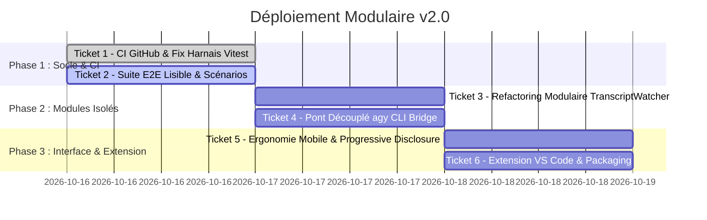

# Master Plan & Diagnostic — Renaissance OmniAntigravity v2.0
> **Rôle :** Principal Software Engineer & Orchestrateur  
> **Référence méthodologique :** Standards d'architecture & gouvernance `Calculateur-tables` (`aiarchitecturerole.md`, `versioning.md`, `instructions.md`)  
> **Dépôt source :** `Madderose/OmniAntigravityRemoteChat` (Fork & Reprise de propriété)  
> **Branche socle :** `feat/native-voice-memo-attachment` (v1.6.0 stable)

---

## 1. Diagnostic de l'Échec CI & Transition de Propriété

### A. Pourquoi la CI a échoué avec *"No jobs were run"* sur `diegosouzapw`
L'analyse de l'exécution GitHub Actions `35090334145` sur la PR #20 montre :
```text
State: completed | Status: action_required
Event: pull_request from Madderose:feat/native-voice-memo-attachment
Jobs: [Aucun job exécuté]
```
* **Cause racine :** Sur GitHub, les dépôts publics disposent par défaut d'une politique de sécurité stricte pour les contributeurs externes et les forks (*"Require approval for first-time contributors / fork PRs"*). Le mainteneur initial (`diegosouzapw`) n'ayant pas validé le déclenchement (ou étant inactif), le workflow passe en `action_required` et expire, provoquant l'alerte e-mail : `Run failed: CI - feat/native-voice-memo-attachment (b0d92f6) - CI: No jobs were run`.

### B. Prise d'autonomie sur votre propre dépôt (`Madderose`)
Puisque le mainteneur initial ne répond plus, nous prenons l'autorité complète sur votre propre dépôt :
1. **GitHub Actions activé sur `Madderose/OmniAntigravityRemoteChat`** : Les permissions ont été configurées via l'API GitHub (`gh api -X PUT repos/Madderose/OmniAntigravityRemoteChat/actions/permissions`).
2. **Déclenchement automatique garanti** : Sur votre dépôt, vous êtes propriétaire. Tout push sur `master`, `main` ou `feat/**` ainsi que toute PR interne déclenchera immédiatement les jobs sans approbation tierce.
3. **Mise à jour du déclencheur CI** : Le fichier `.github/workflows/ci.yml` est configuré pour écouter les branches de développement actif.

---

## 2. Constat & Stratégie de Retour au Socle Sain

### A. Ce qui s'est passé hier (`feat/omni-v2-unified-merge`)
Hier, une fusion massive a été opérée entre la branche `v1.6.0` et l'extension Zero-CDP. Ce merge précipité a engendré :
1. **Pollution UI & Conflits d'ergonomie mobile :** Coexistence confuse entre le bouton `voiceMemoBtn` (mémos vocaux natifs + waveform) et `voiceInputBtn` (dictée Web Speech API), injection brute de pilules d'effort (`effortPills`) brisant la settings-bar sur mobile.
2. **Violation des principes SOLID dans le backend :** Surcharge de `src/server.js` (+1 100 lignes d'un coup), couplage fort entre le serveur HTTP, le watcher de transcript JSONL et le pont CLI `agy`, nécessitant des hacks d'assignation directe aux variables de modules ESM importés.
3. **Régression de perception :** Les raffinements majeurs de la branche mémo vocal (onglets persistants par fenêtre d'IDE, compteurs non-lus O(1), modal de plans d'action avec Proceed direct, modale walkthrough) ont été noyés sous les flux de debug Zero-CDP.

### B. La Décision Stratégique (Recommandée)
Nous revenons à la branche **`feat/native-voice-memo-attachment`** (commit `77d8fd6`), qui constitue le **socle parfait et audité (100% P0/P1 résolus)** :
* ✅ Enregistrement audio natif avec visualiseur waveform & staging multimodal.
* ✅ Multi-onglets de conversations scrollables avec isolation `localStorage` par fenêtre IDE.
* ✅ Badges de messages non-lus ultra-rapides en queue de transcript.
* ✅ Sélecteur d'instance IDE 1-tap en header.
* ✅ Modales dédiées pour la revue des plans d'implémentation et les walkthroughs.
* ✅ Durcissement sécurité 360° (RFC 1918 LAN, jailing symlinks, nettoyage de processus zombies).

À partir de ce socle solide, nous réintégrerons les nouvelles briques (Zero-CDP, CLI `agy`, extension VS Code) **une par une**, sous forme de **modules isolés (Dependency Injection / SOLID)** et accompagnés d'une **suite de tests E2E haute lisibilité**.

---

## 3. Architecture Cible & Principes Directeurs (SOLID & PSE)

```mermaid
graph TD
    Client[📱 Client Mobile PWA] -->|HTTP / WS| CoreServer[🖥️ Core Express Server]
    
    subgraph ModularServices["Services Découplés (SOLID)"]
        CoreServer -->|Injection| SupervisorService[Supervisor & CDP Hub]
        CoreServer -->|Injection| TranscriptWatcher[Transcript Watcher O(1)]
        CoreServer -->|Injection| AgyBridge[Agy CLI Bridge]
        CoreServer -->|Injection| MediaAttachmentService[Media & Voice Service]
    end

    subgraph DataSources["Sources d'Événements"]
        SupervisorService -->|CDP Port 7800-7803| AntigravityIDE[Antigravity IDE GUI]
        TranscriptWatcher -->|Tail read JSONL| TranscriptLogs[Transcripts IDE & agy]
        AgyBridge -->|Process Stream| AgyCliEngine[agy CLI Process]
    end
```

1. **Single Responsibility (SRP) :** `server.js` n'est qu'un routeur et orchestrateur d'entrées/sorties. Les logiques métier (écoute de fichiers, exécution de commande agy, manipulation CDP) vivent dans des classes autonomes injectables.
2. **Open/Closed (OCP) :** Le basculement entre modes (`ide_mirror` vs `direct_agy`) passe par une interface commune `ExecutionEngine` sans modifier les contrôleurs HTTP existants.
3. **Progressive Disclosure (UI/UX) :** L'interface mobile conserve une clarté maximale : pas de boutons concurrents dans le champ de saisie. La dictée vocale et l'enregistrement audio sont unifiés ou affichés de manière contextuelle élégante.
4. **Lisibilité des Tests E2E :** Remplacement des assertions cryptiques par des scénarios rédigés en syntaxe fluide (Given/When/Then), testant le parcours utilisateur réel (enregistrement d'un mémo, bascule d'onglet, notification de plan, exécution agy).

---

## 4. Feuille de Route & Découpage en Tickets



### 🎫 TICKET-01 : Fix Harnais Vitest & Validation CI sur Madderose
* **Objectif :** Résoudre le bug de shebang (`#!/usr/bin/env node`) dans `vitest.config.js` sur `feat/native-voice-memo-attachment` et vérifier que `npm run test:unit` et `npm test` s'exécutent à 100% en local et dans GitHub Actions sur `Madderose`.
* **Livrables :**
  - Ajout du plugin `stripShebang` dans `vitest.config.js`.
  - Harmonisation du fichier `.github/workflows/ci.yml`.
  - Push sur la branche de travail et vérification de l'exécution automatique du pipeline.

### 🎫 TICKET-02 : Suite de Tests E2E à Haute Lisibilité
* **Objectif :** Créer un fichier de tests de scénarios complets (`test/e2e/user-journeys.e2e.test.js`) simulant les cas d'usage réels avec une syntaxe claire et descriptive.
* **Scénarios couverts :**
  1. *Parcours Vocal :* Enregistrement mémo audio -> conversion base64 -> staging -> émission dans le chat.
  2. *Parcours Navigation :* Détection multi-fenêtres IDE -> création d'onglets -> persistance `localStorage` -> isolation des messages non-lus.
  3. *Parcours Décision :* Réception d'un plan d'implémentation -> affichage du modal -> approbation via "Proceed" sans interaction intrusive.
  4. *Parcours Résilience :* Déconnexion réseau temporaire -> reconnexion WebSocket -> resynchronisation sans perte d'état.

### 🎫 TICKET-03 : Extraction Modulaire du Service TranscriptWatcher
* **Objectif :** Isoler la surveillance des fichiers `transcript.jsonl` dans `src/services/transcript-watcher-service.js` respectant SOLID.
* **Critères :** Zéro variable globale, passage d'options par constructeur, émission d'événements standard Node.js (`EventEmitter`).

### 🎫 TICKET-04 : Intégration Robuste du Pont agy CLI (Direct Engine)
* **Objectif :** Intégrer l'exécution directe de l'agent CLI `agy` dans une classe isolée `src/services/agy-bridge-service.js`.
* **Critères :**
  - Support de l'effort de réflexion sans conflit d'arguments.
  - Gestion asynchrone des flux JSON (`--stream-json`).
  - Découplage strict du serveur HTTP principal.

### 🎫 TICKET-05 : Polissage Ergonomique & Progressive Disclosure UI
* **Objectif :** Nettoyer l'interface mobile pour éviter toute surcharge visuelle :
  - Unification élégante de l'action vocale (appui court = dictée texte, appui long / bascule = mémo audio avec waveform).
  - Intégration discrète du sélecteur d'effort dans le panneau de modèle (modal dédié ou menu compact).
  - Validation du rendu sur écran mobile (iPhone, Android, Steam Deck).

### 🎫 TICKET-06 : Cockpit Extension VS Code Découplé
* **Objectif :** Conserver l'extension VS Code dans son sous-dossier `vscode-extension/` comme un module client indépendant communiquant via l'API REST/WS sécurisée.

---

## 5. Gouvernance des Sous-Agents (Calculateur-Tables Pattern)

Conformément à vos directives et aux règles de `Calculateur-tables` :
1. **Orchestrateur Principal (Moi-même) :** Cadre l'architecture, valide les tickets, gère le versionnement SemVer et le `CHANGELOG.md`.
2. **Sub-Agent 1 (Code Specialist) :** Prend en charge l'implémentation des modules backend/services unitaires (TICKET-01, TICKET-03, TICKET-04).
3. **Sub-Agent 2 (Quality & E2E Specialist) :** Rédige et valide les suites de tests E2E ultra-lisibles, garantit la non-régression et audite la couverture (TICKET-02, TICKET-05).
