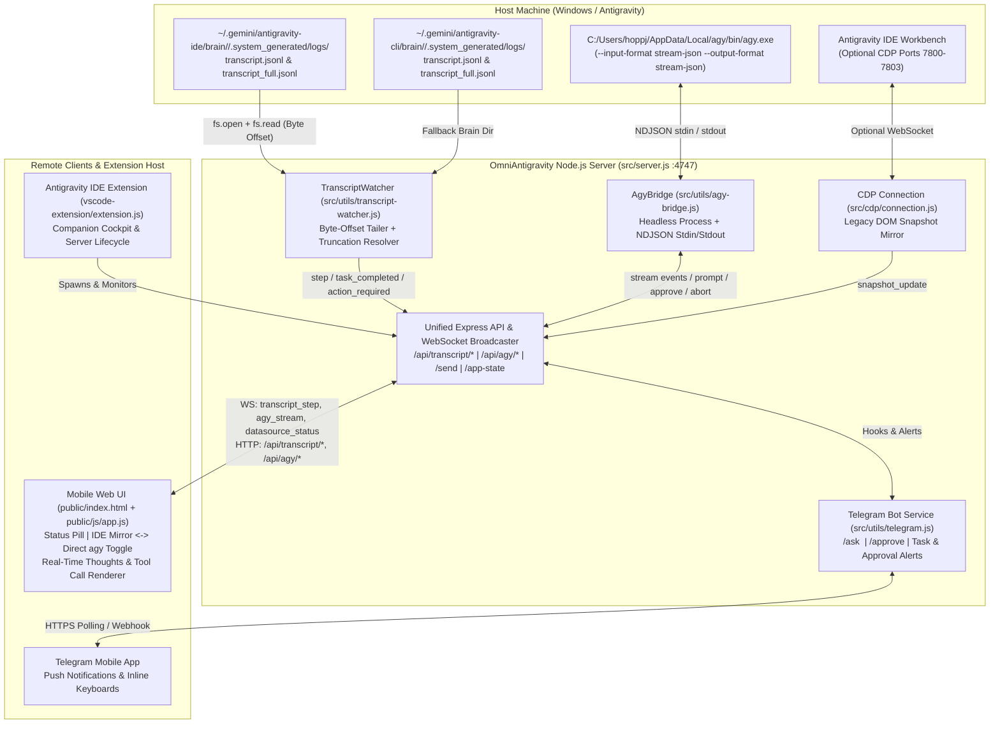

# Master Architecture & Workpackage Execution Plan: Zero-CDP Telemetry & Headless `agy` CLI Engine

**Orchestrator:** Lead Principal Systems & AI Architect (Gemini 4 Argon High)  
**Autonomous Worker Target:** Gemini 4 Argon Medium (`agy`)  
**Target Workspace:** `C:\Users\hoppj\SynologyDrive\01_Projets\OmniAntigravityRemoteChat`  
**Date:** October 2026

---

## 1. Executive Summary & Architecture

### Executive Summary
Currently, **OmniAntigravity Remote Chat** relies on Chrome DevTools Protocol (CDP) on ports `7800–7803` to scrape DOM snapshots from the Antigravity IDE workbench and inject prompts. Whenever Antigravity IDE is launched normally without `--remote-debugging-port=7800`, CDP is unavailable and `/snapshot`, `/send`, `/stop`, and `/chat-history` return `503 Service Unavailable`.

This plan decouples OmniAntigravity Remote Chat from CDP by introducing a **Tri-Modal Engine Architecture**:
1. **Approach 2 — Live Conversation Transcript Watcher (Primary Telemetry / Read Engine):**
   - Incrementally tails `C:\Users\hoppj\.gemini\antigravity-ide\brain\<conversation-id>\.system_generated\logs\transcript.jsonl` (with automatic fallback discovery in `~/.gemini/antigravity-cli/brain/`) using stateful byte-offset tracking, UTF-8 boundary-safe decoding (`StringDecoder`), and line-split buffering.
   - Automatically resolves truncated steps (`is_truncated: true` or non-empty `truncated_fields`) by fetching the full step record from sibling `transcript_full.jsonl`.
   - Streams normalized steps (`step_index`, `source`, `type`, `status`, `content`, `thinking`, `tool_calls`, `media`) over WebSocket (`transcript_step`) and SSE (`/api/transcript/stream`).
2. **Approach 1 — Headless `agy` CLI Bridge (Remote Prompting & Agent Engine):**
   - Spawns and manages `C:\Users\hoppj\AppData\Local\agy\bin\agy.exe` in headless streaming mode (`--input-format stream-json --output-format stream-json`) or single-turn `--print` mode with `--model`, `--effort`, and `--add-dir`.
   - Supports bidirectional NDJSON over `stdin`/`stdout` for multi-turn prompting, real-time thought/tool streaming, and interactive tool call approvals (`/api/agy/approve`).
3. **Unified Mobile UI, Telegram Bot & Extension Host:**
   - **Mobile UI:** Displays a real-time data source status pill (`🟢 Transcript (IDE Live)` | `🤖 agy Headless` | `🖥️ CDP Mirror` | `⚠️ Disconnected`), provides a 1-tap toggle between **IDE Mirror** and **Direct agy Agent**, and renders streaming thoughts (`thinking`) and interactive `tool_calls` cards in real time.
   - **Telegram Bot:** Monitors Transcript Watcher progress when CDP is disconnected to alert on task completion or required input, and adds `/ask <prompt>` to invoke `agy` directly from Telegram.
   - **VS Code Extension:** Passes transcript and `agy` environment paths to the embedded server and surfaces live Transcript + `agy` readiness in the companion sidebar.

---

## 2. Workpackage Breakdown (For Argon 4 Medium)

### WP1: Configuration, Shared State & Live Transcript Watcher
- **Target Files:** `src/config.js`, `src/state.js`, `src/utils/transcript-watcher.js`, `test/unit/transcript-watcher.test.js`.
- **Key Deliverable:** Incremental byte-offset tailing of `transcript.jsonl` with `transcript_full.jsonl` fallback for truncated lines, conversation discovery across IDE and CLI brain paths, and step event emission.
- **Tests:** `npx vitest run test/unit/transcript-watcher.test.js`.

### WP2: Headless `agy` CLI Bridge
- **Target Files:** `src/utils/agy-bridge.js`, `test/unit/agy-bridge.test.js`.
- **Key Deliverable:** Subprocess lifecycle for `C:\Users\hoppj\AppData\Local\agy\bin\agy.exe`, NDJSON streaming over stdin/stdout, model selection (`gemini-4-argon-high`, `gemini-4-argon-medium`, `claude-sonnet-5-5-high`, etc.), tool approval support, and process cancellation.
- **Tests:** `npx vitest run test/unit/agy-bridge.test.js`.

### WP3: Server API Endpoints, WebSocket Multiplexing & Zero-CDP Fallbacks
- **Target Files:** `src/server.js`.
- **Key Deliverable:** REST endpoints (`/api/transcript/*`, `/api/agy/*`, `/api/engine/mode`), WebSocket broadcasting (`transcript_step`, `datasource_status`), fallback logic on `/send`, `/stop`, `/chat-history`, `/app-state` when CDP is disconnected.
- **Tests:** `node --check src/server.js`, `npm run test:unit`.

### 🛑 Checkpoint 1 (Validation from Jonas)
Review WP1–WP3 test runs and verify that transcript discovery and `agy` process management pass all unit tests.

### WP4: Telegram Bot & Mobile Web UI Unification
- **Target Files:** `src/utils/telegram.js`, `public/index.html`, `public/js/app.js`, `public/css/chat.css`.
- **Key Deliverable:** Mobile status badge (`🟢 Transcript Live` / `🤖 agy Headless` / `🖥️ CDP Mirror`), engine toggle chip (`IDE Mirror` ↔ `Direct agy Agent`), real-time thought & tool call rendering, and `/ask <prompt>` Telegram bot command.
- **Tests:** `node --check public/js/app.js`, `node --check src/utils/telegram.js`, `npm run test:unit`.

### WP5: Extension Host Integration & End-to-End Smoke Suite
- **Target Files:** `vscode-extension/extension.js`, `vscode-extension/media/dashboard.js`, `test/test.js`.
- **Key Deliverable:** Extension sidebar indicator for zero-CDP status, passing environment paths to the server, and full integration test validation.
- **Tests:** `node test/test.js` (52+ passed, 0 failed), `npm run test:unit`.

### 🛑 Checkpoint 2 (Final Validation from Jonas) — STATUS: COMPLETED & VERIFIED ✅
Final validation of the complete zero-CDP experience across mobile web, Telegram, and desktop extension:

- **WP1 (Live Transcript Watcher):** ✅ Completed & Verified (`test/unit/transcript-watcher.test.js` 5/5 passed).
- **WP2 (Headless `agy` CLI Bridge):** ✅ Completed & Verified (`test/unit/agy-bridge.test.js` 5/5 passed).
- **WP3 (Server Endpoints & Zero-CDP Fallbacks):** ✅ Completed & Verified (`src/server.js` verified with unit & smoke tests).
- **WP4 (Telegram Bot & Mobile Web UI):** ✅ Completed & Verified (`src/utils/telegram.js`, `public/index.html`, `public/js/app.js`, `public/css/chat.css`).
- **WP5 (Extension Host & Integration Suite):** ✅ Completed & Verified (`vscode-extension/extension.js`, `dashboard.js`, `test/test.js` — **65 passed, 0 failed**).
- **VSIX Artifact:** `vscode-extension/omni-antigravity-remote-1.4.0.vsix` packaged and installed into Antigravity IDE.

