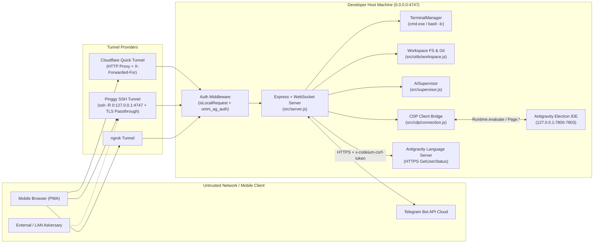
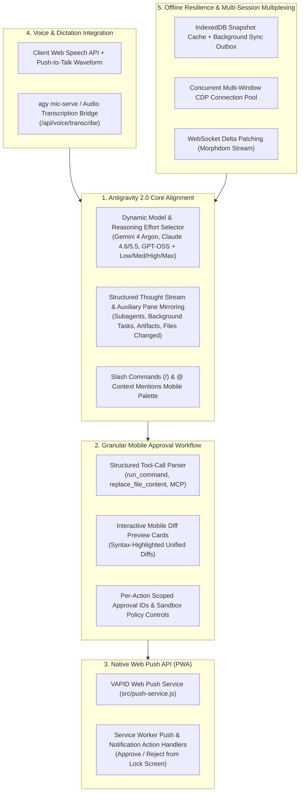

# OmniAntigravity Remote Chat — Comprehensive Security & Feature Audit Report

**Target Codebase:** OmniAntigravity Remote Chat (`v1.3.0` / `package.json v1.3.1`)  
**Audit Date:** October 15, 2026  
**Scope:** Full-Stack Architecture (`src/`, `public/`, `scripts/`, `launcher.js`, `Dockerfile`, `.gitleaks.toml`)  
**Classification:** Publication-Grade Application Security Assessment & Antigravity 2.0 Architectural Roadmap

---

## 1. Executive Summary

**OmniAntigravity Remote Chat** is a Node.js command center that bridges desktop Antigravity AI coding sessions to mobile browsers via the Chrome DevTools Protocol (CDP), WebSocket event streaming, and reverse tunnels (Cloudflare Quick Tunnels, Pinggy SSH tunnels, and ngrok).

While the codebase demonstrates strong engineering practices in modularity, zero-framework frontend responsiveness, defense-in-depth Content Security Policy (`script-src 'self'`), and heuristic safety gating in its AI supervisor, **the security audit identified 14 findings across the stack—including 3 CRITICAL and 5 HIGH severity vulnerabilities**.

> [!CAUTION]
> **Critical Risk Posture:** Because OmniAntigravity Remote Chat exposes a direct OS shell execution endpoint (`POST /api/terminal/run`), a workspace file reader (`GET /api/fs/cat`), and an active CDP bridge to the desktop Electron IDE, **any authentication bypass or cross-origin weakness immediately escalates to full Remote Code Execution (RCE) on the developer's host machine.**

### Summary of Findings

| ID | Severity | CVSS v3.1 | Vulnerability Title | Affected Component(s) |
| :--- | :---: | :---: | :--- | :--- |
| **VULN-01** | **CRITICAL** | **9.8** | Authentication Bypass & Unauthenticated RCE via TLS-Passthrough / SSH Tunnels (`isLocalRequest` Loopback Trust) | `src/utils/network.js`, `scripts/pinggy-tunnel.js`, `src/server.js`, `src/utils/workspace.js` |
| **VULN-02** | **CRITICAL** | **9.6** | Cross-Site WebSocket Hijacking (CSWSH), Missing `SameSite` Cookie Hardening & DNS Rebinding Drive-By RCE | `src/server.js` |
| **VULN-03** | **CRITICAL** | **9.1** | Arbitrary JavaScript Injection in CDP `Runtime.evaluate` Templates (`setModel`, `remoteScroll`, `setMode`) | `src/server.js` |
| **VULN-04** | **HIGH** | **8.8** | Weak 32-Bit `djb2` Session Token (`AUTH_TOKEN`), Hardcoded Default Secrets, Query-String Password Leak & Missing Rate Limiting | `src/config.js`, `src/utils/hash.js`, `src/server.js`, `Dockerfile` |
| **VULN-05** | **HIGH** | **8.6** | Symlink Path Traversal & Unrestricted Reading of `.env` and `certs/server.key` via `/api/fs/cat` | `src/utils/workspace.js`, `src/server.js` |
| **VULN-06** | **HIGH** | **8.2** | AI Supervisor Auto-Approval Bypass via `node -e` Allowlisting, Command Chaining, First-Match Scraping & Blind Multi-Button Clicking | `src/supervisor.js`, `src/server.js` |
| **VULN-07** | **HIGH** | **8.1** | Git Hook Execution & Unvalidated Staging (`git add -A`) in Remote Git Operations | `src/utils/workspace.js`, `src/server.js` |
| **VULN-08** | **HIGH** | **7.5** | DOM/HTML Injection (`innerHTML` / `morphdom`), UI Redressing & Unvalidated Upload Storage in `/api/upload-image` | `public/js/app.js`, `public/js/minimal.js`, `src/utils/workspace.js`, `src/server.js` |
| **VULN-09** | **MEDIUM** | **6.8** | SSH Host Key Verification Disabled (`StrictHostKeyChecking=no`) in Pinggy Tunnel Manager | `scripts/pinggy-tunnel.js` |
| **VULN-10** | **MEDIUM** | **6.5** | Unsanitized Shell Interpolation in `killPortProcess`, Incorrect `--port` Flag & Unthrottled Process Spawning in `/api/launch-window` | `src/utils/process.js`, `src/server.js` |
| **VULN-11** | **MEDIUM** | **6.2** | Sensitive Data Exposure in Git (`data/screenshots` Not Gitignored), `.gitleaks.toml` Gaps & Unescaped Telegram HTML | `.gitignore`, `.gitleaks.toml`, `src/utils/telegram.js`, `src/server.js` |
| **VULN-12** | **LOW** | **4.8** | Shell Command Injection Surface in `scripts/setup-ssl.js` & `scripts/generate_ssl.js` | `scripts/setup-ssl.js`, `scripts/generate_ssl.js` |
| **VULN-13** | **LOW** | **4.3** | Insecure Cookie Transport (`Secure` Flag Omitted When HTTPS/Tunnel Active) & 30-Day Non-Revocable Sessions | `src/server.js` |
| **VULN-14** | **INFO** | **0.0** | State Duplication Between `src/state.js` and `src/server.js` Causing Dead Bindings | `src/state.js`, `src/server.js` |

---

## 2. Architecture & Threat Surface Overview



---

## 3. Deep-Dive Security Vulnerability Analysis

---

### VULN-01: Authentication Bypass & Unauthenticated RCE via TLS-Passthrough / SSH Tunnels (`isLocalRequest` Loopback Trust)

- **Severity:** CRITICAL (CVSS v3.1: **9.8** — `CVSS:3.1/AV:N/AC:L/PR:N/UI:N/S:C/C:H/I:H/A:H`)
- **CWE:** CWE-287 (Improper Authentication), CWE-78 (OS Command Injection)
- **Affected Files:**
  - [`src/utils/network.js`](file:///C:/Users/hoppj/SynologyDrive/01_Projets/OmniAntigravityRemoteChat/src/utils/network.js#L46-L64)
  - [`scripts/pinggy-tunnel.js`](file:///C:/Users/hoppj/SynologyDrive/01_Projets/OmniAntigravityRemoteChat/scripts/pinggy-tunnel.js#L89-L102)
  - [`src/server.js`](file:///C:/Users/hoppj/SynologyDrive/01_Projets/OmniAntigravityRemoteChat/src/server.js#L2422-L2425), [`src/server.js`](file:///C:/Users/hoppj/SynologyDrive/01_Projets/OmniAntigravityRemoteChat/src/server.js#L2938-L2939), [`src/server.js`](file:///C:/Users/hoppj/SynologyDrive/01_Projets/OmniAntigravityRemoteChat/src/server.js#L3165-L3167), [`src/server.js`](file:///C:/Users/hoppj/SynologyDrive/01_Projets/OmniAntigravityRemoteChat/src/server.js#L3396)
  - [`src/utils/workspace.js`](file:///C:/Users/hoppj/SynologyDrive/01_Projets/OmniAntigravityRemoteChat/src/utils/workspace.js#L444-L485)

#### Vulnerable Pattern
In [`src/server.js`](file:///C:/Users/hoppj/SynologyDrive/01_Projets/OmniAntigravityRemoteChat/src/server.js#L2422-L2425) and [`src/server.js`](file:///C:/Users/hoppj/SynologyDrive/01_Projets/OmniAntigravityRemoteChat/src/server.js#L3165-L3167), the server completely bypasses authentication whenever `isLocalRequest(req)` returns `true`:

```javascript
// src/server.js:2422-2425
// Exempt local Wi-Fi devices from authentication
if (isLocalRequest(req)) {
    return next();
}
```

In [`src/utils/network.js`](file:///C:/Users/hoppj/SynologyDrive/01_Projets/OmniAntigravityRemoteChat/src/utils/network.js#L46-L64), `isLocalRequest(req)` determines whether a request is "local" by checking for three HTTP proxy headers and then inspecting the TCP socket IP:

```javascript
// src/utils/network.js:46-56
export function isLocalRequest(req) {
    // Check for proxy headers (Cloudflare, ngrok, etc.)
    if (req.headers['x-forwarded-for'] || req.headers['x-forwarded-host'] || req.headers['x-real-ip']) {
        return false;
    }

    const ip = req.ip || req.socket.remoteAddress || '';

    return ip === '127.0.0.1' ||
        ip === '::1' ||
        ip === '::ffff:127.0.0.1' || ...
```

Meanwhile, when local SSL certificates (`certs/server.key` and `certs/server.cert`) are present, [`src/server.js`](file:///C:/Users/hoppj/SynologyDrive/01_Projets/OmniAntigravityRemoteChat/src/server.js#L2939) and [`src/server.js`](file:///C:/Users/hoppj/SynologyDrive/01_Projets/OmniAntigravityRemoteChat/src/server.js#L3396) start Pinggy with `{ tls: hasSSL, sniServerName: '127.0.0.1' }`, which passes `x:localServerTls:127.0.0.1` to the SSH reverse tunnel in [`scripts/pinggy-tunnel.js`](file:///C:/Users/hoppj/SynologyDrive/01_Projets/OmniAntigravityRemoteChat/scripts/pinggy-tunnel.js#L89-L102):

```javascript
// scripts/pinggy-tunnel.js:89-102
if (options.tls) {
    const suffix = options.sniServerName ? `:${options.sniServerName}` : '';
    remoteOptions.push(`x:localServerTls${suffix}`);
}
...
    '-R', `0:127.0.0.1:${port}`
```

#### Theoretical Proof-of-Concept Explanation
1. **TLS Passthrough & TCP Forwarding Mechanics:** When `x:localServerTls` (or any TCP-level tunnel / SSH port forward) is used, the tunnel edge forwards the raw TLS stream directly to `127.0.0.1:4747` without terminating TLS. Because the tunnel proxy cannot modify the encrypted HTTP payload inside the TLS stream, **no `X-Forwarded-For`, `X-Forwarded-Host`, or `X-Real-IP` headers are injected**.
2. **Loopback Socket Attribution:** On the host machine, the local `ssh` client process establishes the TCP connection to `127.0.0.1:4747`. Therefore, `req.socket.remoteAddress` is `127.0.0.1` (or `::ffff:127.0.0.1`), and `req.headers['x-forwarded-for']` is `undefined`.
3. **Host Header Blindness:** Even when an HTTP proxy is used, `isLocalRequest(req)` never inspects `req.headers.host` (which will be `*.trycloudflare.com`, `*.pinggy.link`, or `*.ngrok-free.app`).
4. **Escalation to RCE:** Any external party who discovers the tunnel URL (e.g., via Certificate Transparency logs or brute-forcing short tunnel subdomains) is treated as a trusted local user and can invoke `POST /api/terminal/run` ([`src/server.js`](file:///C:/Users/hoppj/SynologyDrive/01_Projets/OmniAntigravityRemoteChat/src/server.js#L2760-L2767)), which passes `req.body.command` directly to `cmd.exe /d /s /c` or `bash -lc` in [`src/utils/workspace.js`](file:///C:/Users/hoppj/SynologyDrive/01_Projets/OmniAntigravityRemoteChat/src/utils/workspace.js#L459-L464).
5. **Untrusted LAN Exposure:** Even without a tunnel, `isLocalRequest` trusts the entire `10.0.0.0/8`, `172.16.0.0/12`, and `192.168.0.0/16` address spaces (`src/utils/network.js` lines 58–63). On corporate networks, university Wi-Fi, coworking spaces, or VPNs, every peer on the subnet has unauthenticated RCE on the developer's workstation.

#### Remediation Code Diff

1. **Harden `isLocalRequest(req)` in [`src/utils/network.js`](file:///C:/Users/hoppj/SynologyDrive/01_Projets/OmniAntigravityRemoteChat/src/utils/network.js#L46-L64)** to require explicit opt-in for LAN auto-auth (`ALLOW_LAN_BYPASS=true`), reject non-local `Host` headers (preventing tunnel and DNS rebinding bypasses), and reject requests when a tunnel is active:

```diff
--- a/src/utils/network.js
+++ b/src/utils/network.js
@@ -43,23 +43,43 @@
  *
  * @param {import('express').Request} req
+ * @param {{tunnelActive?: boolean, allowLanBypass?: boolean}} [options]
  * @returns {boolean}
  */
-export function isLocalRequest(req) {
+export function isLocalRequest(req, options = {}) {
+    // Never bypass authentication if a public tunnel is active unless explicitly configured
+    if (options.tunnelActive) {
+        return false;
+    }
+
     // Check for proxy headers (Cloudflare, ngrok, etc.)
-    if (req.headers['x-forwarded-for'] || req.headers['x-forwarded-host'] || req.headers['x-real-ip']) {
+    if (
+        req.headers['x-forwarded-for'] ||
+        req.headers['x-forwarded-host'] ||
+        req.headers['x-real-ip'] ||
+        req.headers['cf-connecting-ip'] ||
+        req.headers['true-client-ip']
+    ) {
         return false;
     }
 
+    // Validate Host header to block tunnel passthroughs and DNS rebinding
+    const rawHost = String(req.headers.host || '').split(':')[0].toLowerCase();
+    const isLoopbackHost = rawHost === 'localhost' || rawHost === '127.0.0.1' || rawHost === '[::1]';
+    const isPrivateLanHost = /^(192\.168\.\d{1,3}\.\d{1,3}|10\.\d{1,3}\.\d{1,3}\.\d{1,3}|172\.(1[6-9]|2\d|3[0-1])\.\d{1,3}\.\d{1,3})$/.test(rawHost);
+    if (!isLoopbackHost && !isPrivateLanHost) {
+        return false;
+    }
+
     const ip = req.ip || req.socket.remoteAddress || '';
+    const isLoopbackIp = ip === '127.0.0.1' || ip === '::1' || ip === '::ffff:127.0.0.1';
+    if (isLoopbackIp && isLoopbackHost) {
+        return true;
+    }
 
-    return ip === '127.0.0.1' ||
-        ip === '::1' ||
-        ip === '::ffff:127.0.0.1' ||
-        ip.startsWith('192.168.') ||
+    if (!options.allowLanBypass) {
+        return false;
+    }
+
+    return ip.startsWith('192.168.') ||
         ip.startsWith('10.') ||
         ip.startsWith('172.16.') || ip.startsWith('172.17.') ||
         ip.startsWith('172.18.') || ip.startsWith('172.19.') ||
         ip.startsWith('172.2') || ip.startsWith('172.3') ||
         ip.startsWith('::ffff:192.168.') ||
         ip.startsWith('::ffff:10.');
 }
```

2. **Gate Remote Terminal Execution behind an explicit feature flag (`ENABLE_REMOTE_TERMINAL`) in [`src/config.js`](file:///C:/Users/hoppj/SynologyDrive/01_Projets/OmniAntigravityRemoteChat/src/config.js) and [`src/server.js`](file:///C:/Users/hoppj/SynologyDrive/01_Projets/OmniAntigravityRemoteChat/src/server.js#L2760-L2767):**

```diff
--- a/src/server.js
+++ b/src/server.js
@@ -2760,6 +2760,9 @@
     app.post('/api/terminal/run', async (req, res) => {
+        if (process.env.ENABLE_REMOTE_TERMINAL === 'false') {
+            return res.status(403).json({ error: 'Remote terminal execution is disabled by server policy' });
+        }
         try {
             const data = await terminalManager.run(String(req.body.command || ''));
             res.json(data);
```

---

### VULN-02: Cross-Site WebSocket Hijacking (CSWSH), Missing `SameSite` Cookie Hardening & DNS Rebinding Drive-By RCE

- **Severity:** CRITICAL (CVSS v3.1: **9.6** — `CVSS:3.1/AV:N/AC:L/PR:N/UI:R/S:C/C:H/I:H/A:H`)
- **CWE:** CWE-352 (Cross-Site Request Forgery), CWE-1385 (Missing Origin Validation in WebSockets), CWE-346 (Origin Validation Error)
- **Affected Files:**
  - [`src/server.js`](file:///C:/Users/hoppj/SynologyDrive/01_Projets/OmniAntigravityRemoteChat/src/server.js#L2429-L2433), [`src/server.js`](file:///C:/Users/hoppj/SynologyDrive/01_Projets/OmniAntigravityRemoteChat/src/server.js#L2466-L2470), [`src/server.js`](file:///C:/Users/hoppj/SynologyDrive/01_Projets/OmniAntigravityRemoteChat/src/server.js#L3146-L3182)

#### Vulnerable Pattern
1. **No `Origin` Check on WebSocket Upgrade:** In [`src/server.js`](file:///C:/Users/hoppj/SynologyDrive/01_Projets/OmniAntigravityRemoteChat/src/server.js#L3146-L3182), `wss.on('connection', (ws, req) => ...)` checks cookies or `isLocalRequest(req)` but **never validates `req.headers.origin`**.
2. **Cookies Missing `sameSite`:** In [`src/server.js`](file:///C:/Users/hoppj/SynologyDrive/01_Projets/OmniAntigravityRemoteChat/src/server.js#L2429-L2433) and [`src/server.js`](file:///C:/Users/hoppj/SynologyDrive/01_Projets/OmniAntigravityRemoteChat/src/server.js#L2466-L2470):
   ```javascript
   res.cookie(AUTH_COOKIE_NAME, AUTH_TOKEN, {
       httpOnly: true,
       signed: true,
       maxAge: 30 * 24 * 60 * 60 * 1000 // 30 days
   });
   ```
3. **No `Host` or `Origin` Validation on State-Mutating POST Endpoints:** Express routes (`/api/terminal/run`, `/send`, `/api/interact-action`, `/api/git/*`) do not verify that `Origin` or `Host` matches the server's expected host.

#### Theoretical Proof-of-Concept Explanation
- **Drive-By WebSocket Surveillance:** When the developer visits any third-party website on their desktop or phone, JavaScript on that page can open a WebSocket to `ws://127.0.0.1:4747` (or `ws://<LAN-IP>:4747`). Because WebSocket handshakes are not restricted by the Same-Origin Policy unless the server validates the `Origin` header, and `isLocalRequest(req)` auto-authenticates the connection, the external website immediately receives real-time terminal output (`terminal_output`), session analytics, and desktop screencast frames (`screen_frame`).
- **DNS Rebinding to RCE:** A malicious webpage visited by the developer can use DNS rebinding so its domain resolves to `127.0.0.1`. Because `src/server.js` does not validate the `Host` header, the browser treats `http://rebound-domain.example:4747` as same-origin and permits `POST /api/terminal/run` with `Content-Type: application/json`, achieving drive-by RCE without any password.

#### Remediation Code Diff

```diff
--- a/src/server.js
+++ b/src/server.js
@@ -2404,6 +2404,22 @@
+    // Origin / CSRF Defense Middleware for state-changing requests
+    app.use((req, res, next) => {
+        if (['POST', 'PUT', 'DELETE', 'PATCH'].includes(req.method)) {
+            const origin = req.headers.origin;
+            const host = req.headers.host;
+            if (origin) {
+                try {
+                    const originHost = new URL(origin).host;
+                    if (host && originHost !== host) {
+                        return res.status(403).json({ error: 'Cross-origin request blocked (CSRF protection)' });
+                    }
+                } catch (_) {
+                    return res.status(403).json({ error: 'Invalid Origin header' });
+                }
+            }
+        }
+        next();
+    });
+
     // Auth Middleware
     app.use((req, res, next) => {
@@ -2429,6 +2445,8 @@
             res.cookie(AUTH_COOKIE_NAME, AUTH_TOKEN, {
                 httpOnly: true,
                 signed: true,
+                sameSite: 'strict',
+                secure: hasSSL || req.secure || req.headers['x-forwarded-proto'] === 'https',
                 maxAge: 30 * 24 * 60 * 60 * 1000 // 30 days
             });
@@ -2466,6 +2484,8 @@
             res.cookie(AUTH_COOKIE_NAME, AUTH_TOKEN, {
                 httpOnly: true,
                 signed: true,
+                sameSite: 'strict',
+                secure: hasSSL || req.secure || req.headers['x-forwarded-proto'] === 'https',
                 maxAge: 30 * 24 * 60 * 60 * 1000 // 30 days
             });
@@ -3146,6 +3166,18 @@
     // WebSocket connection with Auth + Origin check
     wss.on('connection', (ws, req) => {
+        const origin = req.headers.origin;
+        const host = req.headers.host;
+        if (origin && host) {
+            try {
+                if (new URL(origin).host !== host) {
+                    console.log('🚫 Cross-origin WebSocket connection rejected:', origin);
+                    ws.close(1008, 'Cross-origin WebSocket forbidden');
+                    return;
+                }
+            } catch (_) {
+                ws.close(1008, 'Invalid Origin');
+                return;
+            }
+        }
```

---

### VULN-03: Arbitrary JavaScript Injection in CDP `Runtime.evaluate` Templates (`setModel`, `remoteScroll`, `setMode`)

- **Severity:** CRITICAL (CVSS v3.1: **9.1** — `CVSS:3.1/AV:N/AC:L/PR:L/UI:N/S:C/C:H/I:H/A:H`)
- **CWE:** CWE-94 (Improper Control of Generation of Code / Code Injection)
- **Affected Files:**
  - [`src/server.js`](file:///C:/Users/hoppj/SynologyDrive/01_Projets/OmniAntigravityRemoteChat/src/server.js#L1184-L1234) (`remoteScroll`)
  - [`src/server.js`](file:///C:/Users/hoppj/SynologyDrive/01_Projets/OmniAntigravityRemoteChat/src/server.js#L1242-L1380) (`setModel`)
  - [`src/server.js`](file:///C:/Users/hoppj/SynologyDrive/01_Projets/OmniAntigravityRemoteChat/src/server.js#L914-L1010) (`setMode`)

#### Vulnerable Pattern
Although [`SECURITY.md`](file:///C:/Users/hoppj/SynologyDrive/01_Projets/OmniAntigravityRemoteChat/SECURITY.md#L157) states that user inputs are escaped using `JSON.stringify` before CDP injection, **`setModel` and `remoteScroll` interpolate raw request body parameters directly into the JavaScript expression string evaluated via `cdp.call("Runtime.evaluate", ...)`**:

```javascript
// src/server.js:1242-1362 (setModel)
async function setModel(cdp, modelName) {
    const EXP = `(async () => {
        ...
        visibleDialog = dialogs.find(d => d.offsetHeight > 0 && d.innerText?.includes('${modelName}'));
        ...
        let target = validEls.find(el => el.textContent.trim() === '${modelName}');
```

And in [`src/server.js`](file:///C:/Users/hoppj/SynologyDrive/01_Projets/OmniAntigravityRemoteChat/src/server.js#L1184-L1215) (`remoteScroll`):

```javascript
// src/server.js:1184-1215 (remoteScroll)
async function remoteScroll(cdp, { scrollTop, scrollPercent }) {
    const EXPRESSION = `(async () => {
        ...
            if (${scrollPercent} !== undefined) {
                const maxScroll = target.scrollHeight - target.clientHeight;
                target.scrollTop = maxScroll * ${scrollPercent};
            } else {
                target.scrollTop = ${scrollTop || 0};
            }
```

#### Theoretical Proof-of-Concept Explanation
When `POST /set-model` ([`src/server.js`](file:///C:/Users/hoppj/SynologyDrive/01_Projets/OmniAntigravityRemoteChat/src/server.js#L2559-L2564)) or `POST /remote-scroll` ([`src/server.js`](file:///C:/Users/hoppj/SynologyDrive/01_Projets/OmniAntigravityRemoteChat/src/server.js#L3285-L3290)) receives a JSON payload where `model`, `scrollPercent`, or `scrollTop` contains JavaScript syntax instead of a benign model name or number, the unescaped value breaks out of the template literal and executes arbitrary JavaScript across **all execution contexts (`cdp.contexts`)** inside the Antigravity Electron Workbench. Because the Electron renderer has privileged access to internal workbench APIs, credentials, and state, this grants full compromise of the Antigravity IDE.

#### Remediation Code Diff

```diff
--- a/src/server.js
+++ b/src/server.js
@@ -1182,6 +1182,10 @@
 async function remoteScroll(cdp, { scrollTop, scrollPercent }) {
+    const safeScrollPercent = Number.isFinite(Number(scrollPercent)) ? Number(scrollPercent) : null;
+    const safeScrollTop = Number.isFinite(Number(scrollTop)) ? Number(scrollTop) : 0;
+
     // Try to scroll the chat container in Antigravity
     const EXPRESSION = `(async () => {
         try {
@@ -1206,10 +1210,10 @@
             const target = scrollables[0];
             
             // Use percentage-based scrolling for better sync
-            if (${scrollPercent} !== undefined) {
+            if (${safeScrollPercent !== null}) {
                 const maxScroll = target.scrollHeight - target.clientHeight;
-                target.scrollTop = maxScroll * ${scrollPercent};
+                target.scrollTop = maxScroll * ${safeScrollPercent};
             } else {
-                target.scrollTop = ${scrollTop || 0};
+                target.scrollTop = ${safeScrollTop};
             }
             
             return { success: true, scrolled: target.scrollTop };
@@ -1240,8 +1244,10 @@
 async function setModel(cdp, modelName) {
+    const safeModelName = JSON.stringify(String(modelName || ''));
     const EXP = `(async () => {
         try {
+            const targetModelName = ${safeModelName};
             // STRATEGY: Multi-layered approach to find and click the model selector
             const KNOWN_KEYWORDS = ["Gemini", "Claude", "GPT", "Model"];
@@ -1303,7 +1309,7 @@
             // Try specific dialog patterns first
             const dialogs = Array.from(document.querySelectorAll('[role="dialog"], [role="listbox"], [role="menu"], [data-radix-popper-content-wrapper]'));
-            visibleDialog = dialogs.find(d => d.offsetHeight > 0 && d.innerText?.includes('${modelName}'));
+            visibleDialog = dialogs.find(d => d.offsetHeight > 0 && d.innerText?.includes(targetModelName));
             
             // Fallback: look for positioned divs
             if (!visibleDialog) {
                 visibleDialog = Array.from(document.querySelectorAll('div'))
                     .find(d => {
                         const style = window.getComputedStyle(d);
                         return d.offsetHeight > 0 && 
                                (style.position === 'absolute' || style.position === 'fixed') && 
-                               d.innerText?.includes('${modelName}') && 
+                               d.innerText?.includes(targetModelName) && 
                                !d.innerText?.includes('Files With Changes');
                     });
             }
 
             if (!visibleDialog) {
                 // Blind search across entire document as last resort
                 const allElements = Array.from(document.querySelectorAll('[role="menuitem"], [role="option"]'));
                 const target = allElements.find(el => 
                     el.offsetParent !== null && 
-                    (el.innerText?.trim() === '${modelName}' || el.innerText?.includes('${modelName}'))
+                    (el.innerText?.trim() === targetModelName || el.innerText?.includes(targetModelName))
                 );
                 if (target) {
                     target.click();
                     return { success: true, method: 'blind_search' };
                 }
                 return { error: 'Model list not opened' };
             }
 
             // Select specific model inside the dialog
             const allDialogEls = Array.from(visibleDialog.querySelectorAll('*'));
             const validEls = allDialogEls.filter(el => el.children.length === 0 && el.textContent?.trim().length > 0);
             
             // A. Exact Match (Best)
-            let target = validEls.find(el => el.textContent.trim() === '${modelName}');
+            let target = validEls.find(el => el.textContent.trim() === targetModelName);
             
             // B. Page contains Model
             if (!target) {
-                target = validEls.find(el => el.textContent.includes('${modelName}'));
+                target = validEls.find(el => el.textContent.includes(targetModelName));
             }
 
             // C. Closest partial match
             if (!target) {
-                const partialMatches = validEls.filter(el => '${modelName}'.includes(el.textContent.trim()));
+                const partialMatches = validEls.filter(el => targetModelName.includes(el.textContent.trim()));
                 if (partialMatches.length > 0) {
                     partialMatches.sort((a, b) => b.textContent.trim().length - a.textContent.trim().length);
                     target = partialMatches[0];
                 }
             }
@@ -1359,7 +1365,7 @@
                 return { success: true };
             }
 
-            return { error: 'Model "${modelName}" not found in list. Visible: ' + visibleDialog.innerText.substring(0, 100) };
+            return { error: 'Model "' + targetModelName + '" not found in list. Visible: ' + visibleDialog.innerText.substring(0, 100) };
         } catch(err) {
```

---

### VULN-04: Weak 32-Bit `djb2` Session Token (`AUTH_TOKEN`), Hardcoded Default Secrets, Query-String Password Leak & Missing Rate Limiting

- **Severity:** HIGH (CVSS v3.1: **8.8** — `CVSS:3.1/AV:N/AC:L/PR:N/UI:N/S:U/C:H/I:H/A:H`)
- **CWE:** CWE-330 (Use of Insufficiently Random Values), CWE-798 (Use of Hard-coded Credentials), CWE-307 (Improper Restriction of Excessive Authentication Attempts), CWE-598 (Use of GET Request Method With Sensitive Query Strings)
- **Affected Files:**
  - [`src/config.js`](file:///C:/Users/hoppj/SynologyDrive/01_Projets/OmniAntigravityRemoteChat/src/config.js#L42-L45)
  - [`src/utils/hash.js`](file:///C:/Users/hoppj/SynologyDrive/01_Projets/OmniAntigravityRemoteChat/src/utils/hash.js#L14-L22)
  - [`src/server.js`](file:///C:/Users/hoppj/SynologyDrive/01_Projets/OmniAntigravityRemoteChat/src/server.js#L2384), [`src/server.js`](file:///C:/Users/hoppj/SynologyDrive/01_Projets/OmniAntigravityRemoteChat/src/server.js#L2428-L2475)
  - [`Dockerfile`](file:///C:/Users/hoppj/SynologyDrive/01_Projets/OmniAntigravityRemoteChat/Dockerfile#L23)
  - [`launcher.js`](file:///C:/Users/hoppj/SynologyDrive/01_Projets/OmniAntigravityRemoteChat/launcher.js#L230-L235)

#### Vulnerable Pattern
1. **32-Bit Non-Cryptographic `djb2` Token Generation:**
   In [`src/server.js`](file:///C:/Users/hoppj/SynologyDrive/01_Projets/OmniAntigravityRemoteChat/src/server.js#L2384):
   ```javascript
   AUTH_TOKEN = hashString(APP_PASSWORD + AUTH_SALT + Date.now().toString());
   ```
   Where [`hashString`](file:///C:/Users/hoppj/SynologyDrive/01_Projets/OmniAntigravityRemoteChat/src/utils/hash.js#L14-L22) is a 32-bit `djb2` accumulator (`hash = hash & hash; return hash.toString(36)`). This reduces the entire `AUTH_TOKEN` keyspace to at most $2^{32}$ values (and because `djb2` is linear over the suffix `Date.now().toString()`, which is derivable from `serverStartedAt` / `uptime` in `/health` and `/api/admin/metrics`, it provides zero cryptographic unpredictability).
2. **Hardcoded Default `COOKIE_SECRET` and `APP_PASSWORD`:**
   In [`src/config.js`](file:///C:/Users/hoppj/SynologyDrive/01_Projets/OmniAntigravityRemoteChat/src/config.js#L42-L44):
   ```javascript
   export const APP_PASSWORD = process.env.APP_PASSWORD || 'antigravity';
   export const COOKIE_SECRET = process.env.COOKIE_SECRET || 'antigravity_secret_key_1337';
   ```
   And in [`launcher.js`](file:///C:/Users/hoppj/SynologyDrive/01_Projets/OmniAntigravityRemoteChat/launcher.js#L232-L235), if `.env` does not exist, it copies `.env.example` (where `APP_PASSWORD=your-app-password` and `COOKIE_SECRET` is commented out, leaving `COOKIE_SECRET` as `'antigravity_secret_key_1337'`).
3. **No Rate Limiting & Non-Constant-Time Password Comparison:**
   `POST /login` ([`src/server.js`](file:///C:/Users/hoppj/SynologyDrive/01_Projets/OmniAntigravityRemoteChat/src/server.js#L2463-L2475)) and `req.query.key === APP_PASSWORD` ([`src/server.js`](file:///C:/Users/hoppj/SynologyDrive/01_Projets/OmniAntigravityRemoteChat/src/server.js#L2428)) use standard `===` string comparison with **no brute-force rate limiting**.
4. **Password in URL Query String (`?key=`):**
   Accepting the raw `APP_PASSWORD` via `GET /?key=...` leaks the password in proxy access logs, browser history, and `Referer` headers.

#### Remediation Code Diff

```diff
--- a/src/config.js
+++ b/src/config.js
@@ -10,6 +10,7 @@
 import { fileURLToPath } from 'url';
 import { dirname, join } from 'path';
+import { randomBytes } from 'crypto';
 
 const __filename = fileURLToPath(import.meta.url);
@@ -42,3 +43,3 @@
 export const APP_PASSWORD = process.env.APP_PASSWORD || 'antigravity';
-export const COOKIE_SECRET = process.env.COOKIE_SECRET || 'antigravity_secret_key_1337';
+export const COOKIE_SECRET = process.env.COOKIE_SECRET || randomBytes(32).toString('hex');
 export const AUTH_SALT = process.env.AUTH_SALT || '';
```

```diff
--- a/src/server.js
+++ b/src/server.js
@@ -10,6 +10,7 @@
 import './env.js';
 import fs from 'fs';
+import { randomBytes, timingSafeEqual, createHash } from 'crypto';
 import { fileURLToPath } from 'url';
@@ -2383,3 +2384,18 @@
-    // Initialize session security & token
-    AUTH_TOKEN = hashString(APP_PASSWORD + AUTH_SALT + Date.now().toString());
+    // Initialize cryptographically strong 256-bit session token
+    AUTH_TOKEN = randomBytes(32).toString('hex');
+
+    if (!process.env.APP_PASSWORD || APP_PASSWORD === 'antigravity' || APP_PASSWORD === 'your-app-password') {
+        console.warn('⚠️  SECURITY WARNING: Default or placeholder APP_PASSWORD detected! Set a strong APP_PASSWORD in .env before exposing via tunnel.');
+    }
+
+    const loginAttempts = new Map();
+    const MAX_LOGIN_ATTEMPTS = 5;
+    const LOGIN_WINDOW_MS = 15 * 60 * 1000;
+
+    function verifyPasswordConstantTime(candidate, expected) {
+        const a = createHash('sha256').update(String(candidate || '')).digest();
+        const b = createHash('sha256').update(String(expected || '')).digest();
+        return timingSafeEqual(a, b);
+    }
```

And in `/login` ([`src/server.js`](file:///C:/Users/hoppj/SynologyDrive/01_Projets/OmniAntigravityRemoteChat/src/server.js#L2463-L2475)):

```diff
--- a/src/server.js
+++ b/src/server.js
@@ -2463,13 +2479,30 @@
     // Login endpoint with rate limiting and constant-time comparison
     app.post('/login', (req, res) => {
+        const clientIp = req.headers['cf-connecting-ip'] || req.headers['x-forwarded-for'] || req.ip || 'unknown';
+        const now = Date.now();
+        const record = loginAttempts.get(clientIp) || { count: 0, resetAt: now + LOGIN_WINDOW_MS };
+        if (now > record.resetAt) {
+            record.count = 0;
+            record.resetAt = now + LOGIN_WINDOW_MS;
+        }
+        if (record.count >= MAX_LOGIN_ATTEMPTS) {
+            return res.status(429).json({ success: false, error: 'Too many failed login attempts. Try again later.' });
+        }
+
         const { password } = req.body;
-        if (password === APP_PASSWORD) {
+        if (typeof password === 'string' && verifyPasswordConstantTime(password, APP_PASSWORD)) {
+            loginAttempts.delete(clientIp);
             res.cookie(AUTH_COOKIE_NAME, AUTH_TOKEN, {
                 httpOnly: true,
                 signed: true,
+                sameSite: 'strict',
+                secure: hasSSL || req.secure || req.headers['x-forwarded-proto'] === 'https',
                 maxAge: 30 * 24 * 60 * 60 * 1000 // 30 days
             });
             res.json({ success: true });
         } else {
+            record.count += 1;
+            loginAttempts.set(clientIp, record);
             res.status(401).json({ success: false, error: 'Invalid password' });
         }
     });
```

---

### VULN-05: Symlink Path Traversal & Unrestricted Reading of `.env` and `certs/server.key` via `/api/fs/cat`

- **Severity:** HIGH (CVSS v3.1: **8.6** — `CVSS:3.1/AV:N/AC:L/PR:L/UI:N/S:C/C:H/I:N/A:N`)
- **CWE:** CWE-59 (Improper Link Resolution Before File Access / Link Following), CWE-538 (Insertion of Sensitive Information into Externally-Accessible File or Directory)
- **Affected Files:**
  - [`src/utils/workspace.js`](file:///C:/Users/hoppj/SynologyDrive/01_Projets/OmniAntigravityRemoteChat/src/utils/workspace.js#L57-L68), [`src/utils/workspace.js`](file:///C:/Users/hoppj/SynologyDrive/01_Projets/OmniAntigravityRemoteChat/src/utils/workspace.js#L112), [`src/utils/workspace.js`](file:///C:/Users/hoppj/SynologyDrive/01_Projets/OmniAntigravityRemoteChat/src/utils/workspace.js#L136-L208)

#### Vulnerable Pattern
1. **Lexical-Only Path Validation (`path.resolve` without `fs.realpath`):**
   In [`src/utils/workspace.js`](file:///C:/Users/hoppj/SynologyDrive/01_Projets/OmniAntigravityRemoteChat/src/utils/workspace.js#L57-L68), `resolveWorkspacePath` only performs string-based lexical resolution:
   ```javascript
   export function resolveWorkspacePath(inputPath = '.') {
       const normalized = inputPath || '.';
       const absolute = resolve(WORKSPACE_ROOT, normalized);
       const rootWithSep = WORKSPACE_ROOT.endsWith(sep) ? WORKSPACE_ROOT : `${WORKSPACE_ROOT}${sep}`;

       if (absolute !== WORKSPACE_ROOT && !absolute.startsWith(rootWithSep)) {
           throw new Error('Requested path escapes the configured workspace root');
       }
   ```
   When [`listWorkspace`](file:///C:/Users/hoppj/SynologyDrive/01_Projets/OmniAntigravityRemoteChat/src/utils/workspace.js#L139) or [`readWorkspaceFile`](file:///C:/Users/hoppj/SynologyDrive/01_Projets/OmniAntigravityRemoteChat/src/utils/workspace.js#L188) accesses `absolute`, `fsp.readdir(absolute)` and `fsp.open(absolute, 'r')` follow symbolic links and Windows directory junctions without verifying that `await fsp.realpath(absolute)` resides within `await fsp.realpath(WORKSPACE_ROOT)`.
2. **Direct Exposure of `.env` and `certs/server.key`:**
   Because `WORKSPACE_ROOT` defaults to `PROJECT_ROOT` ([`src/config.js`](file:///C:/Users/hoppj/SynologyDrive/01_Projets/OmniAntigravityRemoteChat/src/config.js#L37)), and `readWorkspaceFile` has no sensitive-file denylist (even explicitly mapping `.env` in `guessLanguage` at line 112), calling `GET /api/fs/cat?path=.env` or `GET /api/fs/cat?path=certs/server.key` returns the plaintext `.env` file (containing `APP_PASSWORD`, `COOKIE_SECRET`, `TELEGRAM_BOT_TOKEN`, `NGROK_AUTHTOKEN`, `OMNIROUTE_SUPERVISOR_API_KEY`) and the private TLS key!

#### Remediation Code Diff

```diff
--- a/src/utils/workspace.js
+++ b/src/utils/workspace.js
@@ -14,7 +14,7 @@
 import { EventEmitter } from 'events';
 import { execFile, spawn } from 'child_process';
-import { dirname, extname, join, relative, resolve, sep } from 'path';
+import { basename, dirname, extname, join, relative, resolve, sep } from 'path';
 import { PROJECT_ROOT } from '../config.js';
 
 const WORKSPACE_ROOT = resolve(process.env.WORKSPACE_ROOT || PROJECT_ROOT);
@@ -23,6 +23,14 @@
 const MAX_FILE_BYTES = 512 * 1024;
 const MAX_TERMINAL_LOGS = 500;
 
+const SENSITIVE_PATH_PATTERNS = [
+    /(^|[\\/])\.env(\..+)?$/i,
+    /(^|[\\/])certs[\\/]server\.key$/i,
+    /(^|[\\/])\.git[\\/]config$/i,
+    /(^|[\\/])id_(rsa|ed25519|ecdsa)$/i
+];
+
+function isSensitiveWorkspacePath(relativePath) {
+    return SENSITIVE_PATH_PATTERNS.some((pattern) => pattern.test(relativePath));
+}
+
 /**
  * Ensure a path stays inside the configured workspace.
  *
@@ -64,7 +72,26 @@
     }
 
     const relativePath = absolute === WORKSPACE_ROOT ? '.' : relative(WORKSPACE_ROOT, absolute) || '.';
+    if (isSensitiveWorkspacePath(relativePath)) {
+        throw new Error('Access to sensitive configuration or key files is restricted');
+    }
     return { absolute, relativePath };
 }
+
+/**
+ * Verify that the canonical realpath (resolving symlinks/junctions) stays inside WORKSPACE_ROOT.
+ *
+ * @param {string} targetPath
+ * @returns {Promise<string>}
+ */
+async function assertCanonicalWorkspacePath(targetPath) {
+    const [canonicalRoot, canonicalTarget] = await Promise.all([
+        fsp.realpath(WORKSPACE_ROOT),
+        fsp.realpath(targetPath)
+    ]);
+    const rootWithSep = canonicalRoot.endsWith(sep) ? canonicalRoot : `${canonicalRoot}${sep}`;
+    if (canonicalTarget !== canonicalRoot && !canonicalTarget.startsWith(rootWithSep)) {
+        throw new Error('Symbolic link target escapes the configured workspace root');
+    }
+    return canonicalTarget;
+}
@@ -138,6 +165,7 @@
 export async function listWorkspace(pathLike = '.') {
     await ensureWorkspaceData();
     const { absolute, relativePath } = resolveWorkspacePath(pathLike);
+    await assertCanonicalWorkspacePath(absolute);
     const entries = await fsp.readdir(absolute, { withFileTypes: true });
@@ -180,6 +208,7 @@
 export async function readWorkspaceFile(pathLike) {
     const { absolute, relativePath } = resolveWorkspacePath(pathLike);
+    const canonicalPath = await assertCanonicalWorkspacePath(absolute);
-    const stat = await fsp.stat(absolute);
+    const stat = await fsp.stat(canonicalPath);
```

---

### VULN-06: AI Supervisor Auto-Approval Bypass via `node -e` Allowlisting, Command Chaining, First-Match Scraping & Blind Multi-Button Clicking

- **Severity:** HIGH (CVSS v3.1: **8.2** — `CVSS:3.1/AV:N/AC:L/PR:N/UI:N/S:C/C:H/I:H/A:H`)
- **CWE:** CWE-185 (Incorrect Regular Expression), CWE-863 (Incorrect Authorization), CWE-77 (Command Injection)
- **Affected Files:**
  - [`src/supervisor.js`](file:///C:/Users/hoppj/SynologyDrive/01_Projets/OmniAntigravityRemoteChat/src/supervisor.js#L90-L185), [`src/supervisor.js`](file:///C:/Users/hoppj/SynologyDrive/01_Projets/OmniAntigravityRemoteChat/src/supervisor.js#L619-L669), [`src/supervisor.js`](file:///C:/Users/hoppj/SynologyDrive/01_Projets/OmniAntigravityRemoteChat/src/supervisor.js#L739-L763)
  - [`src/server.js`](file:///C:/Users/hoppj/SynologyDrive/01_Projets/OmniAntigravityRemoteChat/src/server.js#L1907-L1965)

#### Vulnerable Pattern
A four-link vulnerability chain exists in the AI Supervisor's command extraction, heuristic evaluation, and button execution:

1. **First-Match Scraping (`indexOf` instead of `lastIndexOf`):**
   In [`src/supervisor.js`](file:///C:/Users/hoppj/SynologyDrive/01_Projets/OmniAntigravityRemoteChat/src/supervisor.js#L90-L100):
   ```javascript
   export function extractPendingCommand(html) {
       const plain = html.replace(/<[^>]+>/g, ' ').replace(/\s+/g, ' ').trim();
       const runIndex = plain.toLowerCase().indexOf('run command');
       if (runIndex === -1) return '';
       return plain.slice(runIndex, runIndex + 700);
   }
   ```
   Because `indexOf('run command')` finds the **first** occurrence in the entire conversation DOM, once a single benign command (e.g., `Run Command: git status`) has been executed early in the chat, **every subsequent pending command in that conversation will be evaluated by `extractPendingCommand` as that first `git status` command!**
2. **Dangerous `node -e` in `safePatterns` & Unanchored Chaining:**
   In [`src/supervisor.js`](file:///C:/Users/hoppj/SynologyDrive/01_Projets/OmniAntigravityRemoteChat/src/supervisor.js#L148-L182):
   ```javascript
   const safePatterns = [
       ...
       /\bnode\s+-e\b/,
       ...
       /\becho\b/,
   ];
   if (safePatterns.some((pattern) => pattern.test(sample))) {
       return { safe: true, reason: 'heuristic-safe-command' };
   }
   ```
   - `node -e` executes arbitrary Node.js code (`child_process.execSync`, `fs.rmSync`, network exfiltration) and should **never** be in `safePatterns`.
   - `evaluateCommandHeuristics` does not block shell command separators (`;`, `&&`, `||`, `|`, `` ` ``, `$()`, `\r`, `\n`) or PowerShell destructive cmdlets (`Remove-Item`, `Invoke-Expression`, `iex`, `Invoke-WebRequest`, `Start-Process`, `Stop-Process`). Thus, a command containing `echo hello && <arbitrary PowerShell or node script>` matches `/\becho\b/` and is marked `{ safe: true }`!
3. **Indirect Prompt Injection into OmniRoute Supervisor LLM:**
   In [`src/supervisor.js`](file:///C:/Users/hoppj/SynologyDrive/01_Projets/OmniAntigravityRemoteChat/src/supervisor.js#L639-L645), `commandText` (up to 700 chars of untrusted DOM text) is inserted directly into the user message to the LLM without structural delimiters, allowing prompt text after a benign command to instruct the LLM to output `APPROVE`.
4. **Blind Multi-Button Clicking in `completePendingAction`:**
   In [`src/server.js`](file:///C:/Users/hoppj/SynologyDrive/01_Projets/OmniAntigravityRemoteChat/src/server.js#L1927-L1946), `completePendingAction(cdp, 'accept')` clicks **every visible button** matching `['run command', 'allow', 'accept', 'run', 'yes', 'confirm', 'allow once', 'allow this conversation', 'continue', 'proceed']` across the entire DOM!

#### Remediation Code Diff

```diff
--- a/src/supervisor.js
+++ b/src/supervisor.js
@@ -95,7 +95,7 @@
-    const runIndex = plain.toLowerCase().indexOf('run command');
+    const runIndex = plain.toLowerCase().lastIndexOf('run command');
     if (runIndex === -1) return '';
 
     return plain.slice(runIndex, runIndex + 700);
 }
 
 /**
  * Conservative heuristic gate. If it says "unsafe", we do not auto-approve
  * even if the LLM is optimistic.
  *
  * @param {string} commandText
  * @returns {{safe: boolean, reason: string}}
  */
 export function evaluateCommandHeuristics(commandText) {
     const sample = commandText.toLowerCase();
+
+    // Reject shell chaining, subshells, redirection, and PowerShell execution primitives
+    if (/[;&|`$><]|\r|\n/.test(sample)) {
+        return { safe: false, reason: 'heuristic-shell-chaining' };
+    }
+
     const riskyPatterns = [
         /\brm\b/,
         /\bdel\b/,
+        /\berase\b/,
+        /\bremove-item\b/,
+        /\bri\b/,
+        /\biex\b/,
+        /\binvoke-expression\b/,
+        /\binvoke-webrequest\b/,
+        /\binvoke-restmethod\b/,
+        /\bstart-process\b/,
+        /\bstop-process\b/,
+        /\bnode\s+(-e|--eval)\b/,
+        /\bpython3?\s+-c\b/,
         /\bshutdown\b/,
@@ -160,8 +177,6 @@
         /\bls\b/,
         /\bcat\b/,
-        /\bsed\b/,
         /\bnode\s+--check\b/,
-        /\bnode\s+-e\b/,
         /\btsc\s+--noEmit\b/,
```

---

### VULN-07: Git Hook Execution & Unvalidated Staging (`git add -A`) in Remote Git Operations

- **Severity:** HIGH (CVSS v3.1: **8.1** — `CVSS:3.1/AV:N/AC:L/PR:L/UI:N/S:U/C:H/I:H/A:H`)
- **CWE:** CWE-88 (Improper Neutralization of Argument Delimiters in a Command)
- **Affected Files:**
  - [`src/utils/workspace.js`](file:///C:/Users/hoppj/SynologyDrive/01_Projets/OmniAntigravityRemoteChat/src/utils/workspace.js#L283-L308)
  - [`src/server.js`](file:///C:/Users/hoppj/SynologyDrive/01_Projets/OmniAntigravityRemoteChat/src/server.js#L2784-L2809)

#### Vulnerable Pattern
In [`src/utils/workspace.js`](file:///C:/Users/hoppj/SynologyDrive/01_Projets/OmniAntigravityRemoteChat/src/utils/workspace.js#L283-L287):
```javascript
export async function gitAdd(paths = []) {
    const args = paths.length ? ['add', '--', ...paths] : ['add', '-A'];
    await execGit(args);
    return { success: true };
}
```
1. `paths` elements are not validated via `resolveWorkspacePath()` to ensure they are strings and do not reference sensitive files.
2. When `gitAdd([])` is called by the mobile "Add All" button ([`public/js/components/git-panel.js`](file:///C:/Users/hoppj/SynologyDrive/01_Projets/OmniAntigravityRemoteChat/public/js/components/git-panel.js#L121)), `git add -A` stages all untracked files in the workspace—including `data/screenshots/*` (which is missing from `.gitignore`, see VULN-11).

#### Remediation Code Diff

```diff
--- a/src/utils/workspace.js
+++ b/src/utils/workspace.js
@@ -283,6 +283,11 @@
 export async function gitAdd(paths = []) {
-    const args = paths.length ? ['add', '--', ...paths] : ['add', '-A'];
+    const sanitizedPaths = Array.isArray(paths)
+        ? paths.map((p) => resolveWorkspacePath(String(p)).relativePath)
+        : [];
+    const args = sanitizedPaths.length
+        ? ['add', '--', ...sanitizedPaths]
+        : ['add', '-A', '--', '.', ':!data/screenshots', ':!data/uploads', ':!.env*'];
     await execGit(args);
     return { success: true };
 }
```

---

### VULN-08: DOM/HTML Injection (`innerHTML` / `morphdom`), UI Redressing & Unvalidated Upload Storage in `/api/upload-image`

- **Severity:** HIGH (CVSS v3.1: **7.5** — `CVSS:3.1/AV:N/AC:L/PR:N/UI:R/S:C/C:H/I:L/A:N`)
- **CWE:** CWE-79 (Improper Neutralization of Input During Web Page Generation / DOM XSS), CWE-434 (Unrestricted Upload of File with Dangerous Type)
- **Affected Files:**
  - [`public/js/app.js`](file:///C:/Users/hoppj/SynologyDrive/01_Projets/OmniAntigravityRemoteChat/public/js/app.js#L362-L365), [`public/js/app.js`](file:///C:/Users/hoppj/SynologyDrive/01_Projets/OmniAntigravityRemoteChat/public/js/app.js#L380-L389), [`public/js/app.js`](file:///C:/Users/hoppj/SynologyDrive/01_Projets/OmniAntigravityRemoteChat/public/js/app.js#L818-L821), [`public/js/app.js`](file:///C:/Users/hoppj/SynologyDrive/01_Projets/OmniAntigravityRemoteChat/public/js/app.js#L867-L876), [`public/js/app.js`](file:///C:/Users/hoppj/SynologyDrive/01_Projets/OmniAntigravityRemoteChat/public/js/app.js#L998-L1007)
  - [`public/js/minimal.js`](file:///C:/Users/hoppj/SynologyDrive/01_Projets/OmniAntigravityRemoteChat/public/js/minimal.js#L32)
  - [`src/utils/workspace.js`](file:///C:/Users/hoppj/SynologyDrive/01_Projets/OmniAntigravityRemoteChat/src/utils/workspace.js#L362-L385)
  - [`src/server.js`](file:///C:/Users/hoppj/SynologyDrive/01_Projets/OmniAntigravityRemoteChat/src/server.js#L2459), [`src/server.js`](file:///C:/Users/hoppj/SynologyDrive/01_Projets/OmniAntigravityRemoteChat/src/server.js#L2831-L2874)

#### Vulnerable Pattern
1. **Unescaped `innerHTML` Sinks in `public/js/app.js`:**
   - **Line 363 (`showSlideInNotification`):** `<div class="alert-message">${message}</div>` — `message` is not passed through `escapeHtml()`.
   - **Line 383 (`showActionRequiredPrompt`):** `<div class="panel-subtitle modal-copy">${message}</div>` — unescaped `message`.
   - **Lines 869–873 (`renderQuickCommands`):** `${command.id}`, `${command.icon}`, and `${command.label}` are interpolated into `quickActions.innerHTML` without `escapeHtml()`.
   - **Lines 1001–1002 (`showChatHistory`):** `<span>${chat.title}</span>` — conversation titles scraped from the IDE are interpolated into `historyList.innerHTML` without `escapeHtml()`.
2. **Unsanitized `payload.html` & `data-omni-idx` Click Hijacking:**
   In [`public/js/app.js`](file:///C:/Users/hoppj/SynologyDrive/01_Projets/OmniAntigravityRemoteChat/public/js/app.js#L818-L821) and [`public/js/minimal.js`](file:///C:/Users/hoppj/SynologyDrive/01_Projets/OmniAntigravityRemoteChat/public/js/minimal.js#L32), `payload.html` is injected directly into the DOM. While CSP (`script-src 'self'`) prevents inline JS execution, an untrusted prompt or file viewed in the chat can include HTML elements with `data-omni-text="Run"` and `data-omni-idx="0"` styled to cover the viewport (`position: fixed; inset: 0; opacity: 0`). When the mobile user taps the screen, the click listener at [`public/js/app.js`](file:///C:/Users/hoppj/SynologyDrive/01_Projets/OmniAntigravityRemoteChat/public/js/app.js#L1488-L1515) sends `POST /remote-click` to click the real "Run" button on the desktop IDE!
3. **Unvalidated Upload Content & Same-Origin Static Serving (`/uploads`):**
   - [`saveUploadedImage`](file:///C:/Users/hoppj/SynologyDrive/01_Projets/OmniAntigravityRemoteChat/src/utils/workspace.js#L362-L385) does not verify image magic bytes and writes arbitrary decoded bytes to `data/uploads/`.
   - [`src/server.js`](file:///C:/Users/hoppj/SynologyDrive/01_Projets/OmniAntigravityRemoteChat/src/server.js#L2459) serves `/uploads` from the same origin without `X-Content-Type-Options: nosniff`.
   - [`src/server.js`](file:///C:/Users/hoppj/SynologyDrive/01_Projets/OmniAntigravityRemoteChat/src/server.js#L2854) injects the entire multi-megabyte `data:image/...;base64,...` string as raw text into the Antigravity chat editor (``), which can freeze the Lexical editor DOM when large images are uploaded.

#### Remediation Code Diff

```diff
--- a/public/js/app.js
+++ b/public/js/app.js
@@ -360,7 +360,7 @@
   const alert = document.createElement('div');
   alert.className = `slide-in-alert ${escapeHtml(type)}`;
   alert.innerHTML = `
-    <div class="alert-message">${message}</div>
+    <div class="alert-message">${escapeHtml(message)}</div>
     <button class="panel-btn" type="button">Dismiss</button>
   `;
@@ -380,7 +380,7 @@
   layer.innerHTML = `
     <div class="modal-panel">
       <div class="modal-title">Action Required</div>
-      <div class="panel-subtitle modal-copy">${message}</div>
+      <div class="panel-subtitle modal-copy">${escapeHtml(message)}</div>
       <div class="screen-actions">
@@ -867,9 +867,9 @@
   quickActions.innerHTML = state.quickCommands
     .map(
       (command) => `
-        <button class="action-chip" data-quick-command="${command.id}">
-          <span>${command.icon || '•'}</span>
-          <span>${command.label}</span>
+        <button class="action-chip" data-quick-command="${escapeHtml(command.id)}">
+          <span>${escapeHtml(command.icon || '•')}</span>
+          <span>${escapeHtml(command.label)}</span>
         </button>
       `
     )
@@ -998,8 +998,8 @@
     historyList.innerHTML = chats
       .map(
         (chat) => `
-          <button class="history-item ${chat.active ? 'active' : ''}" data-chat-title="${chat.title.replaceAll('"', '&quot;')}">
-            <span>${chat.title}</span>
+          <button class="history-item ${chat.active ? 'active' : ''}" data-chat-title="${escapeHtml(chat.title)}">
+            <span>${escapeHtml(chat.title)}</span>
             <span class="stat-micro">${chat.active ? 'ACTIVE' : 'Open'}</span>
           </button>
         `
```

And in [`src/utils/workspace.js`](file:///C:/Users/hoppj/SynologyDrive/01_Projets/OmniAntigravityRemoteChat/src/utils/workspace.js#L362-L385), validate image magic bytes and cap upload size:

```diff
--- a/src/utils/workspace.js
+++ b/src/utils/workspace.js
@@ -362,6 +362,19 @@
+function hasValidImageMagicBytes(buffer) {
+    if (!buffer || buffer.length < 12) return false;
+    // PNG: 89 50 4E 47 0D 0A 1A 0A
+    if (buffer[0] === 0x89 && buffer[1] === 0x50 && buffer[2] === 0x4E && buffer[3] === 0x47) return true;
+    // JPEG: FF D8 FF
+    if (buffer[0] === 0xFF && buffer[1] === 0xD8 && buffer[2] === 0xFF) return true;
+    // GIF: 47 49 46 38
+    if (buffer[0] === 0x47 && buffer[1] === 0x49 && buffer[2] === 0x46 && buffer[3] === 0x38) return true;
+    // WebP: RIFF....WEBP
+    if (buffer.subarray(0, 4).toString('ascii') === 'RIFF' && buffer.subarray(8, 12).toString('ascii') === 'WEBP') return true;
+    return false;
+}
+
 export async function saveUploadedImage(input) {
     await ensureWorkspaceData();
@@ -375,6 +388,12 @@
     const fileName = `${Date.now()}-${safeBaseName}${safeBaseName.endsWith(extension) ? '' : extension}`;
     const buffer = Buffer.from(input.data, 'base64');
+    if (buffer.length > 10 * 1024 * 1024) {
+        throw new Error('Uploaded image exceeds 10 MB limit');
+    }
+    if (!hasValidImageMagicBytes(buffer)) {
+        throw new Error('Invalid image file signature (must be PNG, JPEG, GIF, or WebP)');
+    }
     const absolutePath = join(UPLOADS_DIR, fileName);
```

---

### VULN-09: SSH Host Key Verification Disabled (`StrictHostKeyChecking=no`) in Pinggy Tunnel Manager

- **Severity:** MEDIUM (CVSS v3.1: **6.8** — `CVSS:3.1/AV:N/AC:H/PR:N/UI:N/S:U/C:H/I:H/A:N`)
- **CWE:** CWE-295 (Improper Certificate / Host Key Validation)
- **Affected Files:**
  - [`scripts/pinggy-tunnel.js`](file:///C:/Users/hoppj/SynologyDrive/01_Projets/OmniAntigravityRemoteChat/scripts/pinggy-tunnel.js#L94-L102)

#### Vulnerable Pattern
In [`scripts/pinggy-tunnel.js`](file:///C:/Users/hoppj/SynologyDrive/01_Projets/OmniAntigravityRemoteChat/scripts/pinggy-tunnel.js#L94-L102):
```javascript
const args = [
    '-p', '443',
    '-T',
    '-o', 'StrictHostKeyChecking=no',
    '-o', 'UserKnownHostsFile=/dev/null',
    '-o', 'ServerAliveInterval=30',
    '-o', 'ExitOnForwardFailure=yes',
    '-R', `0:127.0.0.1:${port}`
];
```
Disabling SSH host key checking (`StrictHostKeyChecking=no` and `UserKnownHostsFile=/dev/null`) allows an active Man-in-the-Middle (MitM) on an untrusted network to intercept the SSH reverse tunnel to `a.pinggy.io:443`, inspect or modify all mobile traffic, and issue commands directly to the local server. (Note also that `/dev/null` is a POSIX path that fails or creates a literal directory path on Windows unless `NUL` or `accept-new` with a dedicated known_hosts file is used.)

#### Remediation Code Diff

```diff
--- a/scripts/pinggy-tunnel.js
+++ b/scripts/pinggy-tunnel.js
@@ -10,6 +10,8 @@
 import { EventEmitter } from 'events';
 import { spawn } from 'child_process';
+import { join } from 'path';
+import { PROJECT_ROOT } from '../src/config.js';
 
 const DEFAULT_BIN = process.env.PINGGY_SSH_BIN || 'ssh';
 const DEFAULT_HOST = process.env.PINGGY_HOST || 'a.pinggy.io';
@@ -94,8 +96,8 @@
         const args = [
             '-p', '443',
             '-T',
-            '-o', 'StrictHostKeyChecking=no',
-            '-o', 'UserKnownHostsFile=/dev/null',
+            '-o', 'StrictHostKeyChecking=accept-new',
+            '-o', `UserKnownHostsFile=${join(PROJECT_ROOT, 'data', 'pinggy_known_hosts')}`,
             '-o', 'ServerAliveInterval=30',
             '-o', 'ExitOnForwardFailure=yes',
             '-R', `0:127.0.0.1:${port}`
```

---

### VULN-10: Unsanitized Shell Interpolation in `killPortProcess`, Incorrect `--port` Flag & Unthrottled Process Spawning in `/api/launch-window`

- **Severity:** MEDIUM (CVSS v3.1: **6.5** — `CVSS:3.1/AV:L/AC:L/PR:L/UI:N/S:U/C:N/I:H/A:H`)
- **CWE:** CWE-78 (OS Command Injection), CWE-400 (Uncontrolled Resource Consumption)
- **Affected Files:**
  - [`src/utils/process.js`](file:///C:/Users/hoppj/SynologyDrive/01_Projets/OmniAntigravityRemoteChat/src/utils/process.js#L18-L51), [`src/utils/process.js`](file:///C:/Users/hoppj/SynologyDrive/01_Projets/OmniAntigravityRemoteChat/src/utils/process.js#L79-L107)
  - [`src/server.js`](file:///C:/Users/hoppj/SynologyDrive/01_Projets/OmniAntigravityRemoteChat/src/server.js#L3335-L3345)

#### Vulnerable Pattern
1. In [`src/utils/process.js`](file:///C:/Users/hoppj/SynologyDrive/01_Projets/OmniAntigravityRemoteChat/src/utils/process.js#L18-L45), `killPortProcess(port)` passes `port` (which comes from `SERVER_PORT = process.env.PORT || 4747`, a string if `process.env.PORT` is set) directly into `execSync(\`netstat -ano | findstr :${port} | findstr LISTENING\`)` or `execSync(\`lsof -ti:${port}\`)` without `Number.parseInt` validation. Furthermore, `findstr :4747` matches any port starting with `4747` (e.g., `47470`) or foreign address `:4747` on a listening line.
2. In [`src/utils/process.js`](file:///C:/Users/hoppj/SynologyDrive/01_Projets/OmniAntigravityRemoteChat/src/utils/process.js#L99), `launchAntigravity()` spawns `spawn('antigravity', [\`--port=${targetPort}\`])` instead of `--remote-debugging-port=${targetPort}`, and `POST /api/launch-window` has no cooldown or maximum instance cap, allowing up to 51 Electron instances (`ports 7800..7850`) to be spawned back-to-back.

#### Remediation Code Diff

```diff
--- a/src/utils/process.js
+++ b/src/utils/process.js
@@ -18,9 +18,13 @@
 export function killPortProcess(port) {
+    const safePort = Number.parseInt(String(port), 10);
+    if (!Number.isFinite(safePort) || safePort <= 0 || safePort > 65535) {
+        return Promise.resolve();
+    }
     try {
         if (process.platform === 'win32') {
-            const result = execSync(`netstat -ano | findstr :${port} | findstr LISTENING`, {
+            const result = execSync(`netstat -ano | findstr /R /C:":${safePort} .*LISTENING"`, {
                 encoding: 'utf8', stdio: ['pipe', 'pipe', 'pipe']
             });
@@ -35,7 +39,7 @@
             }
         } else {
-            const result = execSync(`lsof -ti:${port}`, {
+            const result = execSync(`lsof -ti:${safePort}`, {
                 encoding: 'utf8', stdio: ['pipe', 'pipe', 'pipe']
             });
@@ -98,5 +102,5 @@
     console.log(`Starting antigravity on port ${targetPort}...`);
-    const subprocess = spawn('antigravity', [`--port=${targetPort}`], {
+    const subprocess = spawn('antigravity', [`--remote-debugging-port=${targetPort}`], {
         detached: true,
         stdio: 'ignore'
     });
```

---

### VULN-11: Sensitive Data Exposure in Git (`data/screenshots` Not Gitignored), `.gitleaks.toml` Gaps & Unescaped Telegram HTML

- **Severity:** MEDIUM (CVSS v3.1: **6.2** — `CVSS:3.1/AV:N/AC:L/PR:L/UI:N/S:U/C:H/I:N/A:N`)
- **CWE:** CWE-200 (Exposure of Sensitive Information to an Unauthorized Actor), CWE-116 (Improper Encoding or Escaping of Output)
- **Affected Files:**
  - [`.gitignore`](file:///C:/Users/hoppj/SynologyDrive/01_Projets/OmniAntigravityRemoteChat/.gitignore#L34-L35)
  - [`.gitleaks.toml`](file:///C:/Users/hoppj/SynologyDrive/01_Projets/OmniAntigravityRemoteChat/.gitleaks.toml#L13-L16)
  - [`src/utils/telegram.js`](file:///C:/Users/hoppj/SynologyDrive/01_Projets/OmniAntigravityRemoteChat/src/utils/telegram.js#L283-L300)

#### Vulnerable Pattern
1. **Desktop IDE Screenshots Committed to Git:**
   [`.gitignore`](file:///C:/Users/hoppj/SynologyDrive/01_Projets/OmniAntigravityRemoteChat/.gitignore#L34-L35) ignores `data/uploads/*`, but **does NOT ignore `data/screenshots/*`!** When `screenshotTimeline` captures screenshots of the desktop Antigravity window into `data/screenshots/`, clicking "Add All" -> "Commit" -> "Push" in the mobile Git panel commits and pushes every desktop screenshot and `timeline.json` to the remote Git repository.
2. **Outdated `.gitleaks.toml` Secret Regex:**
   [`.gitleaks.toml`](file:///C:/Users/hoppj/SynologyDrive/01_Projets/OmniAntigravityRemoteChat/.gitleaks.toml#L15) checks for `ollama_supervisor_(model|url)` instead of `omniroute_supervisor_api_key`, `openai_api_key`, and `pinggy_token`.
3. **Unescaped HTML in `sendSuggestionRequired` (`src/utils/telegram.js`):**
   In [`src/utils/telegram.js`](file:///C:/Users/hoppj/SynologyDrive/01_Projets/OmniAntigravityRemoteChat/src/utils/telegram.js#L283-L300), `suggestion.summary`, `suggestion.reason`, and `suggestion.command` are interpolated into a Telegram message with `parse_mode: 'HTML'` without escaping `<`, `>`, or `&`. Any shell command containing `<` or `>` (such as `2>&1` or `cat < file`) causes the Telegram API to reject the message with HTTP 400 (`Can't parse entities`) or renders unintended HTML tags.

#### Remediation Code Diff

```diff
--- a/.gitignore
+++ b/.gitignore
@@ -33,3 +33,6 @@
 data/uploads/*
 !data/uploads/.gitkeep
+data/screenshots/*
+!data/screenshots/.gitkeep
+data/pinggy_known_hosts
```

```diff
--- a/.gitleaks.toml
+++ b/.gitleaks.toml
@@ -13,4 +13,4 @@
 [[rules]]
 id = "env-secret-assignment"
 description = "High-risk environment secret assignment"
-regex = '''(?i)(app_password|cookie_secret|auth_salt|ngrok_authtoken|ollama_supervisor_(model|url)|telegram_chat_id|telegram_bot_token)\s*=\s*.+'''
+regex = '''(?i)(app_password|cookie_secret|auth_salt|ngrok_authtoken|pinggy_token|omniroute_supervisor_api_key|openai_api_key|ollama_supervisor_(model|url)|telegram_chat_id|telegram_bot_token)\s*=\s*.+'''
 tags = ["env", "secret"]
```

```diff
--- a/src/utils/telegram.js
+++ b/src/utils/telegram.js
@@ -280,18 +280,26 @@
+function escapeTelegramHtml(text) {
+    return String(text || '')
+        .replaceAll('&', '&amp;')
+        .replaceAll('<', '&lt;')
+        .replaceAll('>', '&gt;');
+}
+
 /**
  * @param {{id: string, action: 'accept' | 'reject', reason: string, command: string, summary?: string}} suggestion
  */
 export async function sendSuggestionRequired(suggestion) {
     const actionLabel = suggestion.action === 'accept' ? 'approve' : 'reject';
-    const command = String(suggestion.command || 'Pending action').slice(0, 220);
-    const summary = suggestion.summary ? `${suggestion.summary}\n` : '';
+    const command = escapeTelegramHtml(String(suggestion.command || 'Pending action').slice(0, 220));
+    const summary = suggestion.summary ? `${escapeTelegramHtml(suggestion.summary)}\n` : '';
+    const reason = escapeTelegramHtml(suggestion.reason);
     return sendTypedNotification('action_required', [
         '🤖 <b>Supervisor Suggestion</b>',
         summary.trim(),
         `Suggested action: <b>${actionLabel}</b>`,
-        `Reason: <code>${suggestion.reason}</code>`,
+        `Reason: <code>${reason}</code>`,
         '',
         `<code>${command}</code>`
     ].filter(Boolean).join('\n'), {
```

---

### VULN-12: Shell Command Injection Surface in `scripts/setup-ssl.js` & `scripts/generate_ssl.js`

- **Severity:** LOW (CVSS v3.1: **4.8** — `CVSS:3.1/AV:L/AC:H/PR:L/UI:N/S:U/C:L/I:H/A:L`)
- **CWE:** CWE-78 (OS Command Injection)
- **Affected Files:**
  - [`scripts/setup-ssl.js`](file:///C:/Users/hoppj/SynologyDrive/01_Projets/OmniAntigravityRemoteChat/scripts/setup-ssl.js#L175-L178)
  - [`scripts/generate_ssl.js`](file:///C:/Users/hoppj/SynologyDrive/01_Projets/OmniAntigravityRemoteChat/scripts/generate_ssl.js#L121-L123)
  - [`src/server.js`](file:///C:/Users/hoppj/SynologyDrive/01_Projets/OmniAntigravityRemoteChat/src/server.js#L2524-L2538)

#### Vulnerable Pattern
`generate_ssl.js` and `setup-ssl.js` use `execSync` with string concatenation (`execSync(\`mkcert -key-file "${keyFile}" -cert-file "${certFile}" ${ips.join(' ')}\`)` and `execSync(\`${opensslCmd} req -x509 ...\`)`). Furthermore, `POST /generate-ssl` ([`src/server.js`](file:///C:/Users/hoppj/SynologyDrive/01_Projets/OmniAntigravityRemoteChat/src/server.js#L2527)) runs `execSync('node scripts/generate_ssl.js')` synchronously on the main Express event loop thread, blocking all HTTP and WebSocket traffic while RSA-2048 keys are generated. Replace `execSync` with async `execFile` using argument arrays.

---

### VULN-13: Insecure Cookie Transport (`Secure` Flag Omitted) & 30-Day Non-Revocable Sessions

- **Severity:** LOW (CVSS v3.1: **4.3** — `CVSS:3.1/AV:N/AC:L/PR:N/UI:R/S:U/C:L/I:N/A:N`)
- **CWE:** CWE-614 (Sensitive Cookie in HTTPS Session Without 'Secure' Attribute)
- **Affected Files:**
  - [`src/server.js`](file:///C:/Users/hoppj/SynologyDrive/01_Projets/OmniAntigravityRemoteChat/src/server.js#L2429-L2433), [`src/server.js`](file:///C:/Users/hoppj/SynologyDrive/01_Projets/OmniAntigravityRemoteChat/src/server.js#L2466-L2470), [`src/server.js`](file:///C:/Users/hoppj/SynologyDrive/01_Projets/OmniAntigravityRemoteChat/src/server.js#L2478-L2481)

#### Vulnerable Pattern
1. Cookies set on login do not set `secure: true` even when `hasSSL` is true or when accessed via an HTTPS Cloudflare/Pinggy/ngrok tunnel. If the mobile browser later makes a plaintext HTTP request, the signed `omni_ag_auth` cookie is transmitted in cleartext.
2. `POST /logout` ([`src/server.js`](file:///C:/Users/hoppj/SynologyDrive/01_Projets/OmniAntigravityRemoteChat/src/server.js#L2478-L2481)) only clears the client-side cookie (`res.clearCookie(AUTH_COOKIE_NAME)`) without rotating `AUTH_TOKEN` on the server, meaning a stolen cookie remains valid for 30 days until the server process is restarted.

---

### VULN-14: State Duplication Between `src/state.js` and `src/server.js` Causing Dead Bindings

- **Severity:** INFORMATIONAL (CVSS v3.1: **0.0**)
- **Affected Files:**
  - [`src/state.js`](file:///C:/Users/hoppj/SynologyDrive/01_Projets/OmniAntigravityRemoteChat/src/state.js#L40-L77)
  - [`src/server.js`](file:///C:/Users/hoppj/SynologyDrive/01_Projets/OmniAntigravityRemoteChat/src/server.js#L68-L83)

#### Vulnerable Pattern
`src/server.js` imports `* as state from './state.js'` (line 37) and `initCDP()` in `src/cdp/connection.js` (line 189) calls `state.setCdpConnection(conn)`. However, `src/server.js` redeclares local module-scoped variables `let cdpConnection = null; let lastSnapshot = null; let availableTargets = []; let activeTargetId = null; let AUTH_TOKEN = 'ag_default_token';` (lines 68–83) and never updates `state.*` when switching targets, polling snapshots, or generating `AUTH_TOKEN`. Any external module reading from `src/state.js` sees stale/initial values.

---

## 4. Feature & Architectural Roadmap (Antigravity 2.0 Alignment)

To evolve **OmniAntigravity Remote Chat** from a v1.3.0 DOM-mirroring utility into a next-generation mobile command center fully aligned with **Antigravity 2.0**, we propose a 5-pillar architectural upgrade.



---

### Pillar 1: Full Alignment with Antigravity 2.0

#### 1.1 Modern Model Catalog & Dynamic Language Server Sync
Currently, [`public/js/app.js`](file:///C:/Users/hoppj/SynologyDrive/01_Projets/OmniAntigravityRemoteChat/public/js/app.js#L9-L16) hardcodes 6 legacy model labels (`MODELS`), and [`src/quota-service.js`](file:///C:/Users/hoppj/SynologyDrive/01_Projets/OmniAntigravityRemoteChat/src/quota-service.js#L26-L37) maps a static subset of `MODEL_PLACEHOLDER_*` keys.
- **Upgrade `MODEL_NAMES` & `MODELS`** to include first-class support for:
  - **Gemini 4 Argon** (`Gemini 4 Argon (Low)`, `Gemini 4 Argon (Medium)`, `Gemini 4 Argon (High)`, `Gemini 4 Argon (Max)`)
  - **Claude 3.7 / 4.6 / 5.5** (`Claude 3.7 Sonnet (Thinking)`, `Claude Sonnet 4.6 (Thinking)`, `Claude Opus 4.6 (Thinking)`, `Claude 5.5 Sonnet`, `Claude 5.5 Opus`)
  - **GPT-OSS** (`GPT-OSS 120B (Low)`, `GPT-OSS 120B (Medium)`, `GPT-OSS 120B (High)`)
- **Dynamic Model List Hydration:** When `/api/quota` queries the local Antigravity Language Server (`cascadeModelConfigData.clientModelConfigs`), dynamically populate the mobile model selector from `state.quota.models` with fallback to the updated `MODELS` constant.

#### 1.2 Reasoning Effort Controls (`low`, `medium`, `high`, `max`)
Antigravity 2.0 decouples model family selection from reasoning effort (`low`, `medium`, `high`, `max`) or exposes effort tiers in the model/settings popover.
- **Backend Endpoint (`POST /set-reasoning-effort`):** Add a dedicated CDP action in `src/server.js` that inspects the Antigravity 2.0 reasoning effort selector (`[data-tooltip-id*="effort"], [data-tooltip-id*="thinking"], [aria-label*="Effort"], [aria-label*="Thinking"]`) or dispatches the model + effort combination (`Gemini 4 Argon (High)`).
- **Mobile UI Chip:** Add an **Effort** setting chip (`Low` · `Medium` · `High` · `Max`) adjacent to the **Model** chip in `public/index.html` (`.settings-bar`), allowing one-tap adjustment of thinking budget on mobile.

#### 1.3 Thought Stream Mirroring & Antigravity 2.0 Auxiliary Pane Surfaces
In [`public/js/app.js`](file:///C:/Users/hoppj/SynologyDrive/01_Projets/OmniAntigravityRemoteChat/public/js/app.js#L822-L824), every `loadSnapshot()` forcibly executes:
```javascript
chatContent.querySelectorAll('details').forEach((details) => details.setAttribute('open', ''));
```
This overrides the user's manual expand/collapse state on every 1-second poll cycle and causes layout jumps while the model is actively streaming thoughts.
- **Dedicated Thought Stream Extractor:** In `captureSnapshot(cdp)`, tag thought containers (`details`, `[class*="thinking"]`, `[class*="thought"]`) with deterministic `data-thought-id` attributes, extract active streaming thoughts into a structured `snapshot.thoughts[]` array (`{ id, status: 'streaming' | 'complete', durationText, content }`), and preserve user-toggled `open` states across `morphdom` updates via `onBeforeElUpdated`.
- **Antigravity 2.0 Auxiliary Pane & Canvas Enhancements:**
  - Mirror Antigravity 2.0's **Auxiliary Pane** tabs (**Subagents**, **Background Tasks**, **Artifacts**, **Files Changed**, **Terminals**) into the mobile Workspace drawer.
  - Add mobile quick-triggers above `#messageInput` for **Slash Commands (`/`)** (`/plan`, `/goal`, `/boost`, `/compact`, `/grill-me`, `/learn`, `/schedule`) and **`@` Context Mentions** (`@file`, `@folder`, `@terminal`, `@mcp`).

---

### Pillar 2: Granular Mobile Approval Workflow with Inline Diff Previews

Currently, when Antigravity pauses for tool approval:
- `startPolling()` in [`src/server.js`](file:///C:/Users/hoppj/SynologyDrive/01_Projets/OmniAntigravityRemoteChat/src/server.js#L2089) only checks `if (htmlLower.includes('run command') && (htmlLower.includes('reject') || htmlLower.includes('deny')))`—missing file edit approvals, MCP tool calls, browser navigation prompts, and non-workspace file access requests.
- `showActionRequiredPrompt()` in [`public/js/app.js`](file:///C:/Users/hoppj/SynologyDrive/01_Projets/OmniAntigravityRemoteChat/public/js/app.js#L375-L396) shows a generic `"Agent requires approval format (Run Command)"` modal with zero context on *what* command or file diff is being approved.

#### Architectural Design for Granular Approval Cards
1. **Structured Pending Tool-Call Scraper (`extractPendingApprovals(cdp)`):**
   Query all pending approval containers in the Antigravity DOM and extract structured metadata:
   ```json
   {
     "approvalId": "omni-approval-0",
     "toolType": "file_edit | terminal_command | mcp_tool | permission_grant",
     "title": "Edit src/utils/network.js",
     "commandOrPath": "src/utils/network.js#L46-L64",
     "cwd": "C:/Users/hoppj/SynologyDrive/01_Projets/OmniAntigravityRemoteChat",
     "diff": "@@ -46,5 +46,9 @@\n-export function isLocalRequest(req) {\n+export function isLocalRequest(req, options = {}) {",
     "riskLevel": "low | medium | high",
     "availableDecisions": ["accept_once", "reject"]
   }
   ```
2. **Mobile Approval Card UI (`public/js/components/approval-card.js`):**
   Render a rich bottom-sheet card on the phone displaying:
   - Tool badge (`SHELL`, `FILE DIFF`, `MCP`, `SANDBOX`) + risk indicator badge.
   - Syntax-highlighted **Unified / Split Diff Viewer** (with collapsible unchanged hunks and line numbers) or full shell command + working directory.
   - Scoped action buttons (`Approve This Action`, `Reject`, `Ask Supervisor`) that pass the exact `approvalId` (`data-omni-approval-id`) to `POST /api/interact-action` so `completePendingAction` clicks **only** that specific approval card's button rather than every button on the page.

---

### Pillar 3: Real-Time Native Web Push Notifications (PWA)

Currently, background notifications when the mobile browser is locked or backgrounded require configuring a third-party **Telegram Bot** (`src/utils/telegram.js`).

#### Native Web Push Architecture (`src/push-service.js` + `public/sw.js`)
1. **Zero-Config VAPID Key Management (`src/push-service.js`):**
   - On first startup, auto-generate ECDSA P-256 VAPID keys (`publicKey`, `privateKey`) using Node's built-in `crypto` module (or `web-push`) and persist them in `data/vapid.json` (gitignored).
   - Expose `GET /api/push/vapid-public-key`, `POST /api/push/subscribe`, and `DELETE /api/push/unsubscribe` (storing encrypted/authenticated client push subscriptions in `data/push-subscriptions.json`).
2. **Service Worker Push & Interactive Action Buttons (`public/sw.js`):**
   Extend [`public/sw.js`](file:///C:/Users/hoppj/SynologyDrive/01_Projets/OmniAntigravityRemoteChat/public/sw.js) with `push` and `notificationclick` listeners:
   ```javascript
   // public/sw.js addition
   self.addEventListener('push', (event) => {
     const payload = event.data ? event.data.json() : {};
     const options = {
       body: payload.body || 'Antigravity session update',
       icon: '/icons/app-icon.svg',
       badge: '/icons/app-icon-maskable.svg',
       tag: payload.tag || 'omni-ag-alert',
       data: { approvalId: payload.approvalId, suggestionId: payload.suggestionId, url: '/' },
       actions: payload.requiresApproval
         ? [
             { action: 'approve', title: '✅ Approve' },
             { action: 'reject', title: '❌ Reject' },
           ]
         : [],
     };
     event.waitUntil(self.registration.showNotification(payload.title || 'OmniAntigravity', options));
   });

   self.addEventListener('notificationclick', (event) => {
     event.notification.close();
     const { approvalId, suggestionId } = event.notification.data || {};
     if (event.action === 'approve' || event.action === 'reject') {
       const endpoint = suggestionId
         ? `/api/suggestions/${encodeURIComponent(suggestionId)}/${event.action}`
         : '/api/interact-action';
       const body = suggestionId ? {} : { action: event.action === 'approve' ? 'accept' : 'reject', approvalId };
       event.waitUntil(
         fetch(endpoint, {
           method: 'POST',
           headers: { 'Content-Type': 'application/json' },
           body: JSON.stringify(body),
         })
       );
       return;
     }
     event.waitUntil(clients.openWindow('/'));
   });
   ```

---

### Pillar 4: Voice / Dictation Integration (`Web Speech API` & `agy mic-serve`)

Hands-free mobile coding requires seamless voice dictation and voice command execution.
1. **Tier 1 — Client-Side Web Speech API (`SpeechRecognition`):**
   - Add a microphone button (`#voiceInputBtn`) inside `.input-wrapper` in [`public/index.html`](file:///C:/Users/hoppj/SynologyDrive/01_Projets/OmniAntigravityRemoteChat/public/index.html#L209-L221).
   - Use `window.SpeechRecognition || window.webkitSpeechRecognition` with `interimResults: true` and `continuous: true` to stream live dictated text directly into `#messageInput`, with spoken voice-command shortcuts (`"send message"`, `"approve action"`, `"reject action"`, `"switch to planning mode"`).
2. **Tier 2 — `agy mic-serve` / Backend Audio Stream Bridge:**
   - On browsers where `SpeechRecognition` is restricted or when higher accuracy for technical symbols/filenames is needed, capture Opus/WebM audio chunks via `navigator.mediaDevices.getUserMedia({ audio: true })` + `MediaRecorder` (requires HTTPS, already supported via `setup:ssl`).
   - Stream audio via WebSocket (`type: 'voice_chunk'`) or `POST /api/voice/transcribe` to a backend bridge in `src/utils/voice.js` that pipes audio to `agy mic-serve` or an OpenAI-compatible `/v1/audio/transcriptions` endpoint (OmniRoute / local Whisper).

---

### Pillar 5: Offline Resilience & Multi-Session Management

1. **Offline Snapshot Caching & Background Sync Outbox (`public/sw.js` + IndexedDB):**
   - Currently, [`public/sw.js`](file:///C:/Users/hoppj/SynologyDrive/01_Projets/OmniAntigravityRemoteChat/public/sw.js#L69-L79) uses a strict **Cache-First** strategy for all HTML/CSS/JS assets (meaning code updates are never fetched unless `CACHE_NAME` is manually bumped) and does not cache `/snapshot` or `/chat-history`.
   - Switch static assets in `public/sw.js` to **Stale-While-Revalidate**, cache the latest `/snapshot` per target window in IndexedDB (`omni_ag_snapshots`), and queue outgoing messages sent while offline (e.g., in an elevator or subway) in an IndexedDB outbox that flushes automatically upon WebSocket reconnection or Service Worker `sync` event.
2. **True Multi-Session Connection Pool (`src/cdp/connection-pool.js`):**
   - Currently, switching windows via `POST /select-target` ([`src/server.js`](file:///C:/Users/hoppj/SynologyDrive/01_Projets/OmniAntigravityRemoteChat/src/server.js#L3257-L3282)) closes the existing CDP WebSocket (`cdpConnection.ws.close()`), losing background error monitoring and auto-approval supervision on all non-active Antigravity windows!
   - Replace the single `cdpConnection` singleton with a `Map<targetId, CDPTargetSession>` connection pool that maintains lightweight background health/approval listeners across **all** open Antigravity windows simultaneously, broadcasting window-tagged notifications (`{ targetId, title, event: 'action_required' }`) so a developer running parallel agents across 3 repositories can supervise all of them from a single mobile dashboard.
3. **WebSocket Delta Compression:**
   - Instead of broadcasting an empty `snapshot_update` ping that forces every mobile client to make a separate HTTP `GET /snapshot` transfer of 100–500 KB of full HTML + CSS every second, compute and push lightweight DOM/CSS deltas (or cache `snapshot.css` separately by `cssHash` since stylesheet rules rarely change between messages), cutting mobile bandwidth usage by >85%.

---

## 5. Prioritized Remediation & Implementation Action Plan

| Phase | Timeframe | Priority | Action Items |
| :--- | :---: | :---: | :--- |
| **Phase 1: Emergency Security Containment** | **Immediate (Day 1)** | **P0 (Critical)** | 1. Fix `setModel` and `remoteScroll` CDP template injection with `JSON.stringify` / `Number()` coercion (**VULN-03**).<br>2. Harden `isLocalRequest()` to validate `Host` headers, block tunnel passthroughs, and require opt-in for LAN auto-auth (**VULN-01**).<br>3. Add `Origin` validation to WebSocket upgrades and CSRF `Origin`/`Host` middleware + `sameSite: 'strict'` cookies (**VULN-02**). |
| **Phase 2: Access Control & Filesystem Hardening** | **Short-Term (Days 2–3)** | **P1 (High)** | 4. Replace 32-bit `djb2` `AUTH_TOKEN` with `crypto.randomBytes(32).toString('hex')`, add `/login` rate-limiting, and use `crypto.timingSafeEqual` (**VULN-04**).<br>5. Enforce `fs.realpath()` canonical path checks and block `.env` / `certs/server.key` in `resolveWorkspacePath` (**VULN-05**).<br>6. Fix `extractPendingCommand` (`lastIndexOf`), remove `node -e` from `safePatterns`, and reject shell chaining in `evaluateCommandHeuristics` (**VULN-06**).<br>7. Escape all remaining `innerHTML` sinks in `public/js/app.js` and validate image magic bytes in `saveUploadedImage` (**VULN-08**). |
| **Phase 3: Operational & Privacy Hardening** | **Medium-Term (Week 1)** | **P2 (Medium)** | 8. Add `data/screenshots/*` to `.gitignore`, update `.gitleaks.toml`, and escape HTML in `src/utils/telegram.js` (**VULN-11**).<br>9. Enable `StrictHostKeyChecking=accept-new` in `scripts/pinggy-tunnel.js` (**VULN-09**) and sanitize `killPortProcess` / `launchAntigravity` (**VULN-10**).<br>10. Consolidate duplicate state between `src/state.js` and `src/server.js` (**VULN-14**). |
| **Phase 4: Antigravity 2.0 Feature Evolution** | **Roadmap (Weeks 2–4)** | **P3 (Strategic)** | 11. Ship Antigravity 2.0 model list (`Gemini 4 Argon`, `Claude 4.6/5.5`, `GPT-OSS`), Reasoning Effort selector (`Low`/`Med`/`High`/`Max`), and stateful Thought Stream mirroring.<br>12. Implement Granular Mobile Approval Cards with inline unified diff previews.<br>13. Add Native Web Push (VAPID) notifications with lock-screen Approve/Reject buttons in `public/sw.js`.<br>14. Integrate Web Speech API + `agy mic-serve` voice dictation and multi-window CDP connection pooling. |
