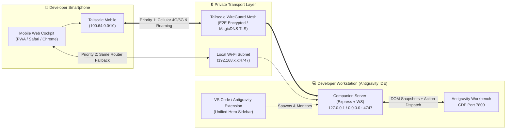

# 🚀 OmniAntigravity Remote Chat — Executive Presentation & Technical Architecture

> **Version 1.4.0** • **Tailscale-First & Local-First Mobile AI Cockpit for Antigravity IDE**

---

## 1. Executive Summary

Modern agentic software engineering in **Antigravity IDE 2.0** involves long-horizon reasoning tasks, multi-file refactorings, and autonomous tool executions powered by frontier models such as **Gemini 4 Argon**, **Claude**, and **GPT**. Yet developers remain physically tethered to their desks to monitor progress, review diffs, or approve terminal commands.

**OmniAntigravity Remote Chat** transforms any smartphone into a low-latency, high-trust **Mobile AI Cockpit**:
- **Zero Cloud Middlemen:** Connects directly from phone to workstation over **Tailscale WireGuard P2P** or **Local Wi-Fi LAN**.
- **Real-Time CDP Mirroring:** Bi-directional synchronization with Antigravity IDE via Chrome DevTools Protocol (`Port 7800`).
- **Concise Single-Card UX:** A unified, responsive sidebar and dashboard engineered for instant QR pairing and 1-click lifecycle control.

---

## 2. System Architecture

### End-to-End Data Flow (Mermaid)



### ASCII Architecture Overview

```text
┌──────────────────────────┐        Tailscale WireGuard P2P (100.x.y.z / *.ts.net)        ┌──────────────────────────────┐
│  📱 Smartphone Browser   │ ◄══════════════════════════════════════════════════════════► │  💻 Companion Server (:4747) │
│  • Live Chat & Reasoning │                  or Local Wi-Fi (192.168.x.x)                │  • Express + WebSocket Sync  │
│  • Diff & Tool Approvals │                                                              │  • SHA-256 Action Validator  │
│  • Voice Dictation       │                                                              │  • Workspace & Git REST API  │
└──────────────────────────┘                                                              └──────────────┬───────────────┘
                                                                                                         │
                                                                                               Localhost │ CDP (:7800)
                                                                                                         ▼
                                                                                          ┌──────────────────────────────┐
                                                                                          │  ⚡ Antigravity IDE 2.0      │
                                                                                          │  • Gemini 4 Argon / Claude   │
                                                                                          │  • Active Editor Workbench   │
                                                                                          └──────────────────────────────┘
```

---

## 3. Security Posture & Threat Model

### Why We Replaced Public Tunnels as the Default

Historically, developer tools relied on ad-hoc reverse tunnels (Cloudflare Quick Tunnels, Pinggy, ngrok) for mobile access. While convenient for public webhook demos, public tunnels introduce unacceptable trade-offs for an IDE command center:

| Security Dimension | 🔒 Tailscale WireGuard Mesh (Default) | 📶 Local Subnet LAN (Fallback) | ⚠️ Public Reverse Tunnels (Legacy) |
| :--- | :--- | :--- | :--- |
| **Attack Surface** | **Private ACL-governed Tailnet only.** Invisible to Shodan/internet scanners. | **Local physical router only.** Unreachable from WAN. | **Publicly resolvable hostname** exposed to global botnets. |
| **Cryptographic Identity** | Device-level WireGuard public/private keys tied to SSO identity. | Local subnet trust + cookie auth (`omni_ag_auth`). | Shared password / bearer cookie over public endpoint. |
| **TLS Termination** | **End-to-end encrypted.** Optional automated Let's Encrypt cert via `tailscale serve`. | Local HTTP or self-signed `mkcert` CA. | Decrypted at third-party edge proxy before re-encryption. |
| **DNS Rebinding & Proxy Hardening** | Strict `Host` validation permits `.ts.net` and `100.64.0.0/10` CGNAT. | Strict `RFC1918` IP validation; blocks spoofed `X-Forwarded-*`. | Requires explicit proxy bypass and rate-limiting. |

### Defense-in-Depth Controls
1. **Strict Content Security Policy (CSP):** Zero inline JavaScript across both the mobile web client and the VS Code webview.
2. **Cryptographic Approval Integrity:** Every mobile tool/diff approval card computes a SHA-256 digest of the pending action text; if the desktop DOM mutates before the mobile tap arrives, execution is rejected.
3. **Heuristic Supervisor Safety Gate:** Destructive shell patterns (`rm -rf /`, disk formatting, credential exfiltration) are blocked at the server boundary.

---

## 4. Antigravity 2.0 Ecosystem Alignment

OmniAntigravity Remote v1.4 is purpose-built for the **Antigravity 2.0** workflow:

- **Frontier Model Orchestration:** Seamlessly switch between **Gemini 4 Argon (High/Max)**, **Claude**, and **GPT** directly from the mobile header bar.
- **Reasoning Effort Control:** Inspect live chain-of-thought reasoning blocks and adjust reasoning effort (`low`, `medium`, `high`, `max`) remotely depending on task complexity.
- **Interactive Tool & Diff Approvals:** When an agent proposes a file edit or shell command in Antigravity IDE, the companion extracts the exact approval context and renders a dedicated mobile decision card.
- **Multi-Window Workbench Switching:** Developers running parallel agent sessions across multiple repositories can switch active CDP targets (`Ports 7800–7803`) in under 2 seconds.

---

## 5. UI / UX Redesign Principles (v1.4.0)

1. **Unified Hero Card:** Consolidates server status, port badge (`:4747`), and `Start / Stop / Restart` controls into a single compact power bar.
2. **Dual-Mode Segmented Switcher:** Instant toggle between **`🔒 Tailscale (Remote)`** and **`📶 Local Wi-Fi`**, dynamically updating both the high-contrast SVG QR code and the contextual network card below it.
3. **Sidebar & Editor Tab Symmetry:** Engineered with fluid CSS grid and flexbox constraints (`280px` narrow sidebar up to full editor tab) with zero horizontal scrollbars.
4. **Progressive Disclosure:** Live server logs and legacy third-party tunnels are housed in collapsible `<details>` accordions, keeping the primary viewport clean and distraction-free.

---

## 6. Roadmap & Community Guide

### Near-Term Roadmap
- **v1.5 — Tailscale Funnel Guardrails:** Optional authenticated webhook endpoint for headless CI/CD agent triggers over Tailscale.
- **v1.6 — Multi-Agent Subagent Tree View:** Dedicated mobile visualization for parallel `invoke_subagent` workflows and background tasks in Antigravity 2.0.
- **v1.7 — Biometric WebAuthn Passkeys:** Hardware-backed FaceID / TouchID re-authentication for sensitive terminal approvals over Tailscale HTTPS.

### Contributing
1. Clone the repository and run `npm install`.
2. Verify the full test suite with `npm test` and `npm run test:unit`.
3. Package and install the extension into Antigravity IDE with `npm run ext:build`.
